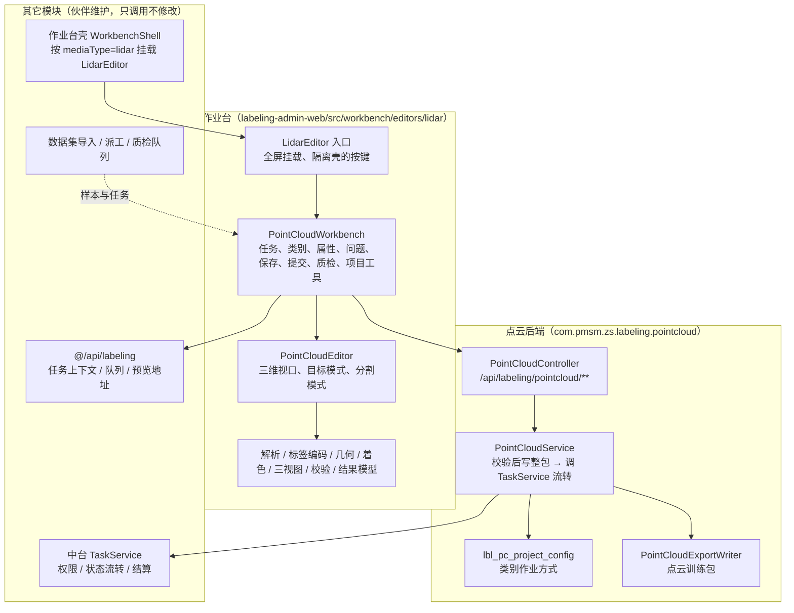

# 三维点云作业平台 · 总体设计与一期范围

| 项 | 内容 |
|----|------|
| 文档编号 | PCD-HLD-001 |
| 版本 | V1.1（一期基线，模块独立版） |
| 日期 | 2026-10-22 |
| 状态 | 设计基线：一期代码已按本文实现；标注“待确认”的事项需在协议评审会上关闭 |
| 代码基础 | `leightonlabs/annotation-platform`（`labeling-server` · `labeling-admin-web`） |
| 输入 | [首次问答](./讨论记录/2026-10-19-首次问答-通用三维点云标注平台架构.md) · [规划对话总结](./讨论记录/2026-10-22-点云标注平台规划-对话总结.md) · annotation-platform 现有设计与代码 |

### 修订记录

| 版本 | 说明 |
|---|---|
| V1.0 | 首版：点云编辑器挂在通用作业台壳下，复用壳的保存/撤销/提交，并修改中台的标注类型、校验与导出 |
| V1.1 | **按模块分工调整**：点云作业台只改点云自己的代码，不再修改作业台壳、中台校验、任务服务、导出作业、公共常量等其它模块；点云作业台自带页面、结果接口、配置与导出 |

---

## 1. 结论先行

1. **以“点云作业台模块”为交付边界**。annotation-platform 由多位开发者分模块维护，其它工作台和中台模块由伙伴负责；点云作业台只在点云自有目录与新包中开发，**不修改任何其它模块的代码**，避免后续合并冲突。
2. **独立的点云作业台**。作业台壳仍按媒体类型（`lidar`）挂载点云入口组件，入口组件以全屏方式打开独立的点云作业台（`PointCloudWorkbench`），由它负责任务加载、类别与属性、问题单、自动保存、撤销、提交、质检通过/驳回、上下条。壳的保存/提交逻辑不参与点云样本。
3. **自带后端接口，复用中台状态机**。新包 `com.pmsm.zs.labeling.pointcloud` 提供 `/api/labeling/pointcloud/**`：结果由点云模块校验并写入样本整包；明细状态流转、权限、结算调用中台 `TaskService` 的公共方法（调用时不传整包），在同一事务内完成。
4. **结果仍是 `lbl-v1` 整包**，存于 `lbl_manifest.annotations_json`；点云扩展字段为根字段 `pointCloud` / `pointSeg` 与立体框（`cuboid`）的三维字段、`trackId`。
5. **逐点标签绑定原始点序**：下标 = 文件原始点序（含无效点占位），以“点序摘要 digest”绑定点云文件；文件变化时禁止继续编辑或提交分割结果。
6. **一期目标**：单帧点云上“打开任务 → 拉框 / 分割 → 自动保存与恢复 → 提交校验 → 质检 / 审核 → 导出训练包”全链路可用。连续帧轨迹、相机联动、实例分割、道路矢量、模型预标进入二期。

---

## 2. 讨论记录中的问题与本设计的处理

| # | 讨论中的问题 | 一期处理 | 状态 |
|---|---|---|---|
| Q1 | 是否为每个甲方开发一个作业平台 | 否。一个点云作业台 + 能力模块（立体框 / 逐点分割）+ 项目配置 + 导出适配器（§3） | 已决定 |
| Q2 | 前端技术栈 | 沿用 Vue 3 + TypeScript + Element Plus + three.js 0.172（仓库已有依赖，不新增依赖） | 已决定 |
| Q3 | 后端技术栈 | 沿用 Java 17 / Spring Boot 3.2 / MyBatis / MySQL；以新包形式加入，不新增服务 | 已决定 |
| Q4 | 基于 Label Studio 二次开发还是自研 | 自研：基于 annotation-platform 已有的派工、质检、结算中台；Label Studio 社区版不含 LiDAR 界面 | 已决定 |
| Q5 | 两类作业的界面差异 | 同一作业台两种模式（目标 / 分割），各自工具栏与侧栏，共享点云视口、着色与裁剪 | 已实现 |
| Q6 | 框与车辆 ID 分开建模 | 每帧框有自己的 `key`；跨帧身份用 `trackId`；本帧内唯一性校验 | 已实现（单帧）；跨帧关联编辑见二期 |
| Q7 | 分割结果如何保存 | `pointSeg`：Uint16 标签数组 → `rle-varint-v1` → base64，嵌在整包；绑定点数与 digest | 已实现；大标签块外置见二期 |
| Q8 | 降采样/过滤/重排导致点与标签错位 | 一期不降采样、不过滤、不重排；无效点占位；digest 校验 | 已实现 |
| Q9 | 坐标系、单位、旋转约定 | 内部约定：右手系、Z 向上、米、航向绕 +Z 逆时针、0° 指向 +X（[02](./02-数据接入规范.md)） | 一期假设，需对每个甲方确认 |
| Q10 | 格式差异（PCD/PLY/LAS/BIN） | 作业台内置解析：PCD（ascii/binary/binary_compressed）、PLY、KITTI BIN、LAS 未压缩、NPY | 已实现；LAZ、自定义 BIN 需转换 |
| Q11 | 规范变更后历史结果 | 类别与属性来自任务冻结的规范版本（中台既有能力）；类别作业方式按项目配置，按 `classId` 生效 | 已实现 |
| Q12 | 混合任务（框 + 分割） | 类别可同时配置两种作业方式；同一任务内切换模式，两层存同一整包，撤销统一 | 已实现 |
| Q13 | “可行驶区域”的几何含义 | 一期不提供三维折线/区域工具；需求方先确认几何含义 | 待确认 → 二期 |
| Q14 | 照片、标定、投影 | 一期不接相机；接入时记录是否有图像与标定 | 二期 |
| Q15 | 2D 抠图辅助分割、模型预标 | 一期不做 | 二期 |
| Q16 | 并发与编辑冲突 | 沿用中台“明细独占领取”；点云作业台 3 秒防抖自动保存，失败时暂存本机 | 已实现 |
| Q17 | 数据规模 | 单帧 ≤ 200 万点为性能保证范围，≤ 800 万点可加载 | 已实现限制；目标硬件实测待做 |
| Q18 | 交付格式 | 点云训练包：逐帧 JSON + OpenPCDet 框 + SemanticKITTI `.label`；专有格式按导出适配器开发 | 已实现通用包 |

---

## 3. 模块边界与组织

### 3.1 边界原则

| 原则 | 说明 |
|---|---|
| 只改自己的目录 | 前端只在 `labeling-admin-web/src/workbench/editors/lidar/` 与 `labeling-admin-web/tests/pointcloud/`；后端只在 `com.pmsm.zs.labeling.pointcloud` 包、`resources/mapper/pointcloud/`、`src/test/.../pointcloud/`，以及新增的迁移脚本 `docs/数据库/labeling_pointcloud_migrate.sql` |
| 调用而不修改 | 允许导入并调用其它模块的公共接口（`getTaskWorkbench`、`TaskService`、`ProjectAccessHelper`、各 Mapper 等），不改它们的代码 |
| 保持既有约定 | 入口组件 `LidarEditor.vue` 保持作业台壳原有的 props / emits，壳侧零改动 |
| 不依赖他人的半成品 | 作业台壳与图像/视频等模块中，有的功能尚未完整实现；点云作业台不复用它们的保存、撤销、提交、校验，按点云需要自建 |

### 3.2 结构

### 3.3 变化如何落地

| 需求变化 | 处理方式 | 位置 |
|---|---|---|
| 类别、颜色、属性、必填项 | 改规范（规范库，既有能力），发布新版本 | 无需开发 |
| 某类别拉框 / 分割 / 两者 | 点云作业台“项目工具 → 类别作业方式” | 无需开发 |
| 新的作业工具（折线、实例、关键点） | 点云作业台内新增能力模块 | 点云前端 |
| 新输入格式 / 自定义 BIN 布局 | 预处理转换；高频时扩展 `pointCloudFormats.ts` | 点云前端 |
| 甲方专有交付格式 | 新增导出写出器（以 [03](./03-标注结果协议.md) 为输入） | 点云后端 |
| 需要伙伴模块配合的事项 | 列入 [07 §7 对接事项](./07-研发规范与一期计划.md#7-与伙伴模块的对接事项)，由对方决定是否、何时调整 | 协商 |

### 3.4 代码位置（一期）

| 模块 | 位置 | 职责 |
|---|---|---|
| 入口 | `editors/lidar/LidarEditor.vue` | 保持壳的原有约定；全屏挂载点云作业台 |
| 作业台 | `editors/lidar/PointCloudWorkbench.vue` | 任务上下文、类别、属性、问题单、自动保存、撤销、提交、质检、上下条、项目工具 |
| 三维编辑器 | `editors/lidar/PointCloudEditor.vue` | 两种模式的工具与手势 |
| 结果模型 | `editors/lidar/pointCloudTypes.ts` · `pointCloudResult.ts` | 点云结果模型与 `lbl-v1` 往返（保留未建模字段） |
| 接口 | `editors/lidar/pointCloudApi.ts` | `/api/labeling/pointcloud/**` |
| 撤销 | `editors/lidar/pointCloudHistory.ts` | 整帧快照前后栈 |
| 解析 / 标签 / 几何 / 着色 / 视口 / 三视图 / 校验 | `pointCloudFormats.ts` · `pointLabels.ts` · `cloudGeometry.ts` · `cloudColors.ts` · `pointCloudScene.ts` · `ThreeViewPanel.vue` · `lidarValidation.ts` | 点云核心能力 |
| 后端接口 | `pointcloud/controller/PointCloudController.java` | 草稿、提交、质检保存、通过、驳回、配置、导出 |
| 后端服务 | `pointcloud/service/impl/PointCloudServiceImpl.java` | 校验写入 + 调用 `TaskService` 流转 |
| 校验 / 编码 / 配置 / 导出 | `pointcloud/support/PointCloudResultValidator` · `PointSegCodec` · `PointCloudModes` · `PointCloudExportWriter` | 与前端规则一致 |
| 配置表 | `lbl_pc_project_config` · `pointcloud/mapper/LblPcProjectConfigMapper` | 项目级类别作业方式 |

---

## 4. 一期范围

### 4.1 必须交付

| 编号 | 能力 | 说明 |
|---|---|---|
| F1 | 点云接入 | PCD（ascii/binary/binary_compressed）、PLY、KITTI BIN、LAS 未压缩、NPY；无效点占位；大坐标自动平移局部原点 |
| F2 | 显示与浏览 | 透视/俯视、适应、双击设旋转中心；按高度/强度/RGB/类别着色；点大小；显示高度裁剪；地面估计与调整 |
| F3 | 立体框 | 地面拖拽新建、手柄平移/旋转、三视图精调、数值编辑、贴合点云、掉头、方向键微调、跟踪 ID、自动编号 |
| F4 | 逐点分割 | 套索、矩形、笔刷、框内点赋类；涂抹/擦除；默认只改未标注点；按类隐藏；各类点数统计 |
| F5 | 作业台 | 类别列表与数字热键、属性表单、对象列表、问题单、自动保存与本机暂存、撤销/重做、上下条 |
| F6 | 提交校验 | 前端硬错误/提醒 + 后端严格校验（框几何、跟踪 ID、类别作业方式、必填属性、分割层绑定与调色板） |
| F7 | 质检审核 | 对框或整帧提问题；质检改动、通过、驳回；返工时逐条标记已解决 |
| F8 | 项目工具 | 类别作业方式配置；导出数据集点云训练包 |

### 4.2 一期明确不做

| 不做 | 原因 / 去向 |
|---|---|
| 修改作业台壳、中台校验/任务服务/导出作业、公共常量 | 模块分工；需要配合的事项列入对接清单 |
| 连续帧序列作业 | 需要序列数据模型与相邻帧加载，二期 |
| 相机图像联动、标定、投影 | 需真实标定样本，二期 |
| 实例分割 / 全景分割 | 协议已预留，二期 |
| 三维折线、区域、道路拓扑 | 几何含义待确认（Q13），二期 |
| 模型预标、2D 掩码辅助分割 | 二期 |
| 超大点云分块 / LOD / Worker 解析 | 二期性能专项 |
| LAZ、自定义 BIN 在线解析 | 预处理阶段转换 |

> 若首个合同要求以上某项，它就属于该项目的首版范围，按 [07 §6](./07-研发规范与一期计划.md#6-变更控制) 评估，不因本表默认延后。

---

## 5. 核心设计决策（ADR 摘要）

| 编号 | 决策 | 理由 |
|---|---|---|
| ADR-1 | 点云作业台为独立页面，经现有入口组件全屏挂载 | 不改作业台壳即可接入；壳的保存/撤销/提交按图像场景设计，会丢失点云字段 |
| ADR-2 | 点云自带后端接口写结果，状态流转调用 `TaskService`（不传整包），同一事务 | 中台通用规范化会把立体框改写为矩形、丢弃分割层；不改中台代码时只能由点云模块自己写结果 |
| ADR-3 | 结果继续用 `lbl-v1` 整包 | 与平台“整包 JSON、不拆宽表”的约定一致；导出、结算等仍能读取 `shapes` |
| ADR-4 | 分割标签 = 原始点序 Uint16 数组 + RLE + base64 | 每点一个对象体积不可接受；保存选区多边形无法表达逐点结果 |
| ADR-5 | 点序摘要（两路 FNV-1a）绑定标签 | 只比点数发现不了重排或替换；内网 HTTP 下浏览器无 `crypto.subtle` |
| ADR-6 | 类别作业方式存点云自己的项目配置（默认只拉框） | 不改规范库与公共几何常量即可区分拉框类与分割类；按 `classId` 生效，跨规范版本稳定 |
| ADR-7 | 航向角落库用“度”，导出换算弧度 | 兼容已有 `lbl-v1` 立体框字段 |
| ADR-8 | 局部坐标渲染、原始坐标落库 | 避免大坐标在 float32 下丢精度 |
| ADR-9 | 一期不降采样、主线程解析 | 降采样需显示点↔原始点映射，二期随分块/LOD 一并设计 |
| ADR-10 | 选区作用于所有显示中的点（含被遮挡点），以高度裁剪、隐藏类别、“仅改未标注”限定范围 | 只选可见表面需深度读回，二期评估 |

---

## 6. 文档地图

| 文档 | 读者 | 内容 |
|---|---|---|
| [02-数据接入规范](./02-数据接入规范.md) | 数据接入、项目经理、研发 | 格式、坐标、点序与摘要、数据包、规模、拒收条件 |
| [03-标注结果协议](./03-标注结果协议.md) | 研发、交付 | `lbl-v1` 点云扩展、编码、校验、接口、导出包 |
| [04-项目规范配置](./04-项目规范配置.md) | 项目管理员 | 建项目、规范类别与属性、类别作业方式、跟踪 ID、版本 |
| [05-作业台设计与操作规范](./05-作业台设计与操作规范.md) | 标注员、质检员、研发 | 界面、工具、快捷键、拉框与分割作业标准 |
| [06-作业流程与质量规范](./06-作业流程与质量规范.md) | 全体 | 13 个环节的输入/操作/输出/准出、质检与验收 |
| [07-研发规范与一期计划](./07-研发规范与一期计划.md) | 研发、项目经理 | 模块边界、代码与测试规范、部署、排期、验收用例、对接事项、风险、路线图 |
| [08-一期交付说明](./08-一期交付说明.md) | 项目负责人、伙伴开发者 | 本次交付内容、验证记录、已知问题与下一步 |
