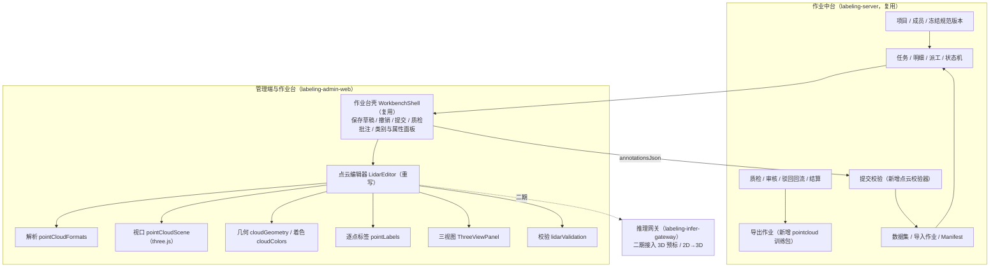

# 三维点云作业平台 · 总体设计与一期范围

| 项 | 内容 |
|----|------|
| 文档编号 | PCD-HLD-001 |
| 版本 | V1.0（一期基线） |
| 日期 | 2026-10-22 |
| 状态 | 设计基线：一期代码首版已按本文实现；标注“待确认”的事项需在协议评审会上关闭 |
| 代码基础 | `leightonlabs/annotation-platform`（`labeling-server` · `labeling-admin-web` · `labeling-infer-gateway`） |
| 输入 | [首次问答](./讨论记录/2026-10-19-首次问答-通用三维点云标注平台架构.md) · [规划对话总结](./讨论记录/2026-10-22-点云标注平台规划-对话总结.md) · annotation-platform 现有设计（概要设计 LBL-HLD-001、对象模型、能力地图） |

---

## 1. 结论先行

1. **不另起平台**。三维点云作业平台 = annotation-platform 的作业中台（项目、规范、数据集、派工、草稿、提交、质检、审核、结算、导出） + 升级后的**点云编辑器族**（`lidar`）。中台状态机、权限、结算不做任何分叉。
2. **按“任务能力”扩展，不按甲方扩展**。一期在一个点云编辑器里提供两种作业模式：**目标模式**（三维立体框 + 跟踪 ID）与**分割模式**（逐点语义标签）。启用哪种模式由**冻结规范中类别声明的几何**决定，不写死在代码里。
3. **结果仍是整包 JSON（`lbl-v1`）**，沿用 `lbl_manifest.annotations_json`，不建宽表、不加表；点云相关字段以根字段 `pointCloud` / `pointSeg` 与立体框字段扩展（见 [03-标注结果协议](./03-标注结果协议.md)）。
4. **逐点标签绑定原始点序**。标签数组下标 = 文件中的原始点序（含无效点占位），并用“点序摘要 digest”绑定具体点云；点云文件变化时禁止继续编辑/提交分割结果，避免标签错位。
5. **一期目标**：单帧点云上“导入 → 派工 → 拉框/分割 → 保存恢复 → 提交校验 → 质检/审核 → 导出训练包”全链路可用。连续帧轨迹编辑、相机联动、实例分割、道路矢量、模型预标进入二期。

---

## 2. 讨论记录中的问题与本设计的处理

讨论记录是方向性建议，不是定案。下表把其中的开放问题逐条落到“一期决定 / 一期假设（需确认）/ 后续”。

| # | 讨论中的问题 | 一期处理 | 状态 |
|---|---|---|---|
| Q1 | 是否为每个甲方开发一个作业平台 | 否。统一平台 + 能力模块 + 规范配置 + 导出适配器（§3） | 已决定 |
| Q2 | 前端技术栈 | 沿用 Vue 3 + TypeScript + Pinia + Element Plus + three.js 0.172（仓库已有依赖，不新增依赖） | 已决定 |
| Q3 | 后端技术栈 | 沿用 Java 17 / Spring Boot 3.2 / MyBatis Plus / MySQL；不新增服务 | 已决定 |
| Q4 | 基于 Label Studio 二次开发还是自研 | 自研：annotation-platform 已有原生作业台与中台，三方引擎已在原项目中“后置，默认不做”；Label Studio 社区版不含 LiDAR 界面 | 已决定 |
| Q5 | 两类作业的界面差异 | 同一编辑器两种模式，各自工具栏与侧栏（目标：三视图 + 框属性；分割：类别点数统计）；共享点云视口与着色/裁剪 | 已实现 |
| Q6 | 框与车辆 ID 分开建模 | 每帧框有自己的 `key`；跨帧身份用 `trackId` 字段；本帧内唯一性校验 | 已实现（单帧）；跨帧关联编辑见二期 |
| Q7 | 分割结果如何保存 | `pointSeg`：Uint16 标签数组 → `rle-varint-v1` → base64，嵌在整包 JSON；绑定点数与 digest | 已实现；大标签块外置对象存储见二期 |
| Q8 | 降采样/过滤/重排导致点与标签错位 | 一期**不降采样、不过滤、不重排**，无效点保留占位；digest 校验 | 已实现 |
| Q9 | 坐标系、单位、旋转约定 | 内部约定：右手系、Z 轴向上、米、航向角绕 +Z 逆时针、0° 指向 +X（[02-数据接入规范](./02-数据接入规范.md)） | 一期假设，需对每个甲方确认 |
| Q10 | 格式差异（PCD/PLY/LAS/BIN） | 编辑器内置解析：PCD（ascii/binary/binary_compressed）、PLY、KITTI BIN、LAS 1.0–1.4 未压缩、NPY | 已实现；LAZ、自定义 BIN 布局需转换 |
| Q11 | 规范变更后历史结果 | 沿用原平台“本体版本冻结”：任务创建时冻结版本，规范升级不改已绑定任务 | 已有能力 |
| Q12 | 混合任务（框 + 分割） | 类别同时声明两种几何即可在同一任务内切换模式；两层分别保存在同一整包，撤销统一 | 已实现 |
| Q13 | “可行驶区域”是折线还是区域、俯视还是曲面 | 一期不提供三维折线/区域工具；需求方先确认几何含义 | 待确认 → 二期 |
| Q14 | 照片、标定、投影 | 一期不接相机；数据接入时记录是否附带图像与标定，供二期使用 | 二期 |
| Q15 | 2D 抠图辅助分割、模型预标 | 一期不做；推理网关已有 SAM 能力，二期接入投影链路 | 二期 |
| Q16 | 并发与编辑冲突 | 沿用原平台“单任务明细独占领取”（仅执行人可保存/提交）；草稿 5 秒防抖云端保存 | 已有能力 |
| Q17 | 数据规模 | 一期单帧 ≤ 200 万点为性能保证范围，≤ 800 万点可加载；更大点云需分块后导入 | 已实现限制；真实硬件性能待测 |
| Q18 | 交付格式 | 通用点云包：逐帧 JSON + OpenPCDet 框文本 + SemanticKITTI `.label`；甲方专有格式以“导出适配器”开发 | 已实现通用包；专有格式待样本 |

---

## 3. 平台组织与复用关系

### 3.1 变化如何落地（配置、模块、适配器的边界）

| 需求变化 | 处理方式 | 一期落点 |
|---|---|---|
| 类别、颜色、属性、必填项、枚举 | 改规范（本体）并发布新版本 | 规范库，无需开发 |
| 某项目只做框 / 只做分割 / 两者都做 | 规范中类别声明的几何（`cuboid` / `point_seg`） | 规范库，无需开发 |
| 新的作业工具（折线、实例、关键点） | 开发能力模块（编辑器内新模式或新工具） | 代码 |
| 新输入格式 / 自定义 BIN 布局 | 数据适配（预处理转换为一期支持格式，或扩展解析器） | 预处理脚本或 `pointCloudFormats.ts` |
| 甲方专有交付格式 | 导出适配器（`DatasetPackZipWriter` 新格式） | 代码 |
| 独立内网部署 | 部署配置，同一套代码 | 运维 |

### 3.2 关键代码位置（一期）

| 模块 | 位置 | 职责 |
|---|---|---|
| 点云解析 | `labeling-admin-web/src/workbench/editors/lidar/pointCloudFormats.ts` | 各格式 → 统一结构；原始点序；局部原点；digest |
| 逐点标签 | `.../lidar/pointLabels.ts` | Uint16 标签、`rle-varint-v1` 编解码、统计、调色板重映射 |
| 几何 | `.../lidar/cloudGeometry.ts` | 框内点、贴合、地面估计、投影与屏幕选区 |
| 着色 | `.../lidar/cloudColors.ts` | 高度/强度/RGB/类别着色、显示裁剪、高亮 |
| 视口 | `.../lidar/pointCloudScene.ts` | three.js 点渲染、立体框、变换手柄、视角、拾取 |
| 三视图 | `.../lidar/ThreeViewPanel.vue` | 俯视/侧视/后视精调 |
| 编辑器 | `.../lidar/LidarEditor.vue` | 模式与工具、手势、快捷键、结果读写 |
| 前端校验 | `.../lidar/lidarValidation.ts` | 提交前硬错误/提醒 |
| 结果模型 | `labeling-admin-web/src/utils/workbenchAnnotation.ts` | `pointCloud` / `pointSeg` / `trackId` 解析与序列化 |
| 壳集成 | `labeling-admin-web/src/workbench/shell/WorkbenchShell.vue` | 草稿、撤销（含分割层）、提交校验、质检钉 |
| 后端校验 | `labeling-server/.../util/PointCloudAnnotationValidator.java` | 提交时校验框、绑定、分割层 |
| 后端编解码 | `labeling-server/.../util/PointSegCodec.java` | 与前端一致的 RLE 编解码 |
| 导出 | `labeling-server/.../util/DatasetPackZipWriter.java`（`pointcloud`） | 训练包 |
| 类型与几何 | `AnnotationTypeCodes` / `LabelingGeometry` / `AnnotationTypeCatalog` | 新增 `point_seg` |

---

## 4. 一期范围

### 4.1 必须交付（本期验收口径）

| 编号 | 能力 | 说明 |
|---|---|---|
| F1 | 点云接入 | PCD（ascii/binary/binary_compressed）、PLY（ascii/二进制）、KITTI BIN、LAS 未压缩、NPY；无效点占位；远距离坐标自动平移局部原点 |
| F2 | 显示与浏览 | 透视/俯视、适应、双击设旋转中心；按高度/强度/RGB/类别着色；点大小；显示高度裁剪；地面高度估计与调整 |
| F3 | 立体框 | 地面拖拽新建（高度按框内点估计、朝向沿长边）、选中、平移/旋转手柄、三视图拖动精调、数值编辑、贴合点云、掉头、方向键微调、跟踪 ID、自动编号 |
| F4 | 逐点分割 | 套索、矩形、笔刷、框内点赋类；涂抹/擦除；默认只改未标注点、可切换覆盖；按类隐藏；各类点数与未标注统计 |
| F5 | 保存与恢复 | 草稿自动保存（云端 + 本地）；刷新恢复；撤销/重做覆盖框与分割层 |
| F6 | 提交校验 | 前端硬错误/提醒 + 后端严格校验（框几何、跟踪 ID 唯一、分割层点数/摘要/调色板/类别几何） |
| F7 | 质检审核 | 沿用质检/审核队列、通过/驳回、回流；质检可对选中框或整帧提问题；质检改动保留三维字段与分割层 |
| F8 | 导出 | `pointcloud` 训练包：`classes.json`、`annotations/*.json`、`openpcdet/*.txt`、`semantic/*.label` |
| F9 | 规范配置 | 标注类型新增“点云语义分割（point_seg）”；本体类别可声明几何 `point_seg`；模式由几何驱动 |

### 4.2 一期明确不做（避免范围蔓延）

| 不做 | 原因 / 去向 |
|---|---|
| 连续帧序列作业（时间轴、上一帧复制、插值、跨帧 ID 关联检查） | 需要“序列”数据模型与相邻帧加载接口，二期 |
| 相机图像联动、标定管理、2D↔3D 投影 | 需真实标定样本验证，二期 |
| 实例分割 / 全景分割 | 协议已预留（见 03 §6），二期 |
| 三维折线、区域、道路拓扑 | 几何含义待甲方确认（Q13），二期 |
| 模型预标、2D 掩码辅助分割 | 二期接推理网关 |
| 超大点云分块 / LOD / Web Worker 解析 | 二期性能专项 |
| LAZ、自定义 BIN 布局在线解析 | 一期在数据预处理阶段转换 |

> 若首个合同要求以上某项，它就属于该项目的首版范围，按 [07-研发规范与一期计划](./07-研发规范与一期计划.md) §6 走变更评估，不因本表而默认延后。

---

## 5. 核心设计决策（ADR 摘要）

| 编号 | 决策 | 备选与否决理由 |
|---|---|---|
| ADR-1 | 点云编辑器作为原作业台的一个编辑器族，壳与中台复用 | 独立前端项目：会复制派工/保存/质检逻辑，违背“统一平台” |
| ADR-2 | 结果继续用整包 JSON（`lbl-v1` 扩展） | 新建标签表：违反原项目“整包 JSON、不拆宽表”规范；一期规模下 JSON 足够 |
| ADR-3 | 分割标签 = 原始点序 Uint16 数组 + RLE + base64 | 每点一个对象：体积与性能不可接受；按选区多边形保存：无法表达逐点结果 |
| ADR-4 | 点序摘要（两路 FNV-1a，覆盖点数/原点/坐标字节）绑定标签 | 只比点数：重排或替换同点数文件时无法发现；SHA-256：内网 HTTP 环境浏览器 `crypto.subtle` 不可用 |
| ADR-5 | 模式由类别几何声明驱动（`cuboid` / `point_seg`） | 由“标注类型”单值驱动：无法表达混合任务 |
| ADR-6 | 航向角落库用“度”（沿用原 `lbl-v1` cuboid 字段），导出时换算弧度 | 改为弧度：破坏已有数据兼容 |
| ADR-7 | 局部坐标渲染、原始坐标落库 | 直接用原始坐标渲染：UTM 等大坐标在 float32 下精度损失 |
| ADR-8 | 一期不降采样、主线程解析 | 降采样需维护显示点↔原始点映射，二期与分块/LOD 一并设计 |
| ADR-9 | 选区作用于视口中所有可见点（含被遮挡点），用显示裁剪、隐藏类别、“仅改未标注”限定范围 | 只选可见表面点：需深度缓冲读回，二期评估 |

---

## 6. 文档地图

| 文档 | 读者 | 内容 |
|---|---|---|
| [02-数据接入规范](./02-数据接入规范.md) | 数据接入、项目经理、研发 | 格式、坐标、点序、数据包、规模、拒收条件 |
| [03-标注结果协议](./03-标注结果协议.md) | 研发、交付 | `lbl-v1` 点云扩展、编码、校验、导出包 |
| [04-项目规范配置](./04-项目规范配置.md) | 项目管理员 | 建项目、规范类别与几何、属性、版本 |
| [05-作业台设计与操作规范](./05-作业台设计与操作规范.md) | 标注员、质检员、研发 | 界面、工具、快捷键、拉框与分割作业标准 |
| [06-作业流程与质量规范](./06-作业流程与质量规范.md) | 全体 | 各环节的输入/操作/输出/准入准出、质检与验收 |
| [07-研发规范与一期计划](./07-研发规范与一期计划.md) | 研发、项目经理 | 代码与测试规范、部署参数、排期、验收用例、风险、路线图 |
