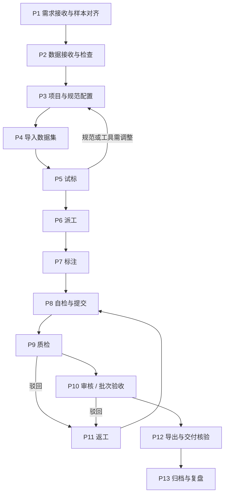

# 点云作业流程与质量规范

| 项 | 内容 |
|----|------|
| 文档编号 | PCD-SPEC-PROCESS-001 |
| 版本 | V1.0（一期） |
| 日期 | 2026-10-22 |
| 适用 | 项目经理、数据接入、规范维护、标注员、质检员、审核员、交付 |

本文把一个点云项目从“接单”到“交付”拆成 13 个环节，每个环节规定**谁做、拿什么、做什么、交出什么、怎样才算完成**。平台内的环节（导入、派工、标注、质检、审核、导出）沿用 annotation-platform 的状态机：明细 `todo → doing → submitted → accepted / rejected`，阶段 `annotate → review → audit`。

---

## 1. 角色

| 角色 | 平台角色 | 职责 |
|---|---|---|
| 项目经理 | project_admin | 需求对齐、排期、派工、验收组织、交付 |
| 数据接入 | project_admin / 系统管理员 | 数据接收检查、预处理、导入 |
| 规范维护 | project_admin | 规范（本体）编写与发布、作业说明 |
| 标注员 | annotator | 标注、自检、返工 |
| 质检员 | reviewer | 全检或抽检、提问题、通过/驳回 |
| 审核员 | auditor | 终审、批次验收 |
| 研发 | — | 适配器、缺陷修复、工具支持 |

## 2. 流程总览

## 3. 各环节规范

### P1 需求接收与样本对齐

| 项 | 内容 |
|---|---|
| 负责 | 项目经理（规范维护、研发参与） |
| 输入 | 甲方需求说明、标注规范、样本数据、期望交付样例 |
| 操作 | 1）按 [01 §2](./01-总体设计与一期范围.md#2-讨论记录中的问题与本设计的处理) 逐项确认：任务类型（拉框/分割/混合/跟踪）、类别与属性、坐标系与单位、作业范围、跟踪 ID 规则、交付格式；2）判断哪些靠配置、哪些需开发（[04 §8](./04-项目规范配置.md#8-配置还是开发判定表)）；3）超出一期范围的需求走变更评估 |
| 输出 | 《项目说明》：任务定义、类别表、作业标准差异项、交付格式、验收指标、排期 |
| 准出 | 甲方确认《项目说明》；交付格式已映射到 `pointcloud` 包或已立项适配器 |

### P2 数据接收与检查

| 项 | 内容 |
|---|---|
| 负责 | 数据接入 |
| 输入 | 数据包与《数据说明》 |
| 操作 | 按 [02 §6](./02-数据接入规范.md#6-接收检查清单) 检查 D1–D9；需要时做格式/坐标/单位转换（导入前完成，记录脚本与参数） |
| 输出 | 检查记录、（可能的）转换后数据、批次台账 |
| 准出 | D1–D9 全部通过；不满足 [02 §7](./02-数据接入规范.md#7-拒收或退回条件) 的批次退回 |

### P3 项目与规范配置

| 项 | 内容 |
|---|---|
| 负责 | 规范维护、项目经理 |
| 操作 | 建项目（点云 + 标注类型）；在规范库建类别、几何、颜色、导出码、编号、属性，发布版本并钉定；设置质检/审核开关与驳回策略（默认“回原标注员”） |
| 输出 | 已发布规范版本、项目配置 |
| 准出 | [04 §9](./04-项目规范配置.md#9-派工前配置检查清单) C1–C6 通过 |

### P4 导入数据集

| 项 | 内容 |
|---|---|
| 负责 | 数据接入 |
| 操作 | 建数据集，按文件大小选择上传 / zip / OSS 键清单导入；核对导入报告的成功数、重复数、失败数 |
| 输出 | Manifest（样本）列表 |
| 准出 | 样本数 = 批次文件数；抽 3 个样本在作业台打开正常 |

### P5 试标

| 项 | 内容 |
|---|---|
| 负责 | 项目经理组织，2–3 名标注员 + 1 名质检员 |
| 操作 | 每类任务 20–50 帧，完整走一遍标注 → 质检 → 审核 → 导出 → 核验；记录单帧用时、驳回原因分布 |
| 输出 | 试标报告：效率基线、规范歧义清单、工具问题清单 |
| 准出 | 导出结果经甲方或内部核验通过；规范歧义已在规范/项目说明中澄清；P7 的单帧工时基线确定 |

### P6 派工

| 项 | 内容 |
|---|---|
| 负责 | 项目经理 |
| 操作 | 从数据集建标注任务；跟踪项目**按序列整段派给同一标注员**（一期跨帧 ID 一致性依赖同一人连续作业）；设置截止时间 |
| 输出 | 任务与明细 |
| 准出 | 每条明细有执行人或进入认领池；跟踪项目无“同一序列多人分片” |

### P7 标注

| 项 | 内容 |
|---|---|
| 负责 | 标注员 |
| 操作 | 按 [05 作业台设计与操作规范](./05-作业台设计与操作规范.md) §6（拉框）、§7（分割）作业；跟踪项目按帧号顺序作业 |
| 输出 | 草稿（自动保存） |
| 准出 | 完成本帧全部作业范围 |

### P8 自检与提交

| 项 | 内容 |
|---|---|
| 负责 | 标注员 |
| 操作 | 按 [05 §8](./05-作业台设计与操作规范.md#8-提交前自检) S1–S6 自检后提交；处理全部硬错误，提醒项逐条确认 |
| 输出 | 已提交结果（后端严格校验通过） |
| 准出 | 平台提交成功；无未处理的质检问题（返工时） |

### P9 质检

| 项 | 内容 |
|---|---|
| 负责 | 质检员（不得质检自己标注的样本，平台强制） |
| 操作 | 按 §5 检查；小问题可直接修改后“改完并通过”；需要标注员修改的提问题并驳回 |
| 输出 | 通过 / 驳回 + 问题单 |
| 准出 | 每条明细有结论；驳回必有原因码或问题单 |

### P10 审核 / 批次验收

| 项 | 内容 |
|---|---|
| 负责 | 审核员 |
| 操作 | 对质检通过的样本按 §5.3 抽审；按 §6 计算批次指标 |
| 输出 | 审核结论、批次验收记录 |
| 准出 | 批次指标达到验收阈值；未达标批次整批退回质检复核 |

### P11 返工

| 项 | 内容 |
|---|---|
| 负责 | 原标注员（驳回策略“回原标注员”） |
| 操作 | 在作业台右栏“待改问题”逐条修改并标记已解决，再次提交 |
| 准出 | 全部问题已解决；同一样本返工超过 2 次由项目经理介入（规范歧义或能力问题） |

### P12 导出与交付核验

| 项 | 内容 |
|---|---|
| 负责 | 项目经理（研发协助） |
| 操作 | 建导出作业：格式“点云 zip”，勾选“仅已验收”；下载后按 §7 核验 |
| 输出 | 交付包、核验记录 |
| 准出 | §7 全部通过；甲方签收 |

### P13 归档与复盘

| 项 | 内容 |
|---|---|
| 负责 | 项目经理 |
| 操作 | 归档项目说明、规范版本、数据台账、导出作业号、核验记录；复盘效率与缺陷分布，形成规范/工具改进项 |
| 输出 | 复盘记录、改进清单（进入下一期需求） |

## 4. 状态与平台对应

| 业务状态 | 平台状态 |
|---|---|
| 待作业 / 作业中 | 明细 `todo` / `doing`（草稿已存） |
| 已提交待质检 | 标注明细 `accepted`；开启自动下游时生成质检明细，否则由项目经理建质检任务 |
| 质检通过待审核 | 质检明细 `accepted`，生成审核明细 |
| 验收通过 | 样本 `asset_status = accepted` |
| 驳回返工 | 明细 `rejected`，回流新标注明细给原标注员 |

## 5. 质检规范

### 5.1 缺陷分级

| 等级 | 立体框 | 逐点分割 |
|---|---|---|
| 严重 | 漏标目标；类别错误；朝向反向（≈180°）；跟踪 ID 串号（不同目标同 ID 或同一目标换 ID） | 大面积错类（某目标 > 20% 点错类）；作业范围内成片未标注 |
| 一般 | 贴合超差（面偏差 > 0.1 m 或 > 5%）；朝向误差超过 5°（车辆）/ 15°（行人）；必填属性错误 | 目标边界错标超过 2%；类别边界规则未遵守 |
| 轻微 | 非必填属性错误；贴合接近阈值 | 零星孤立错点 |

### 5.2 帧判定

- 有任一**严重**缺陷：不通过。
- **一般**缺陷 ≥ 2 处：不通过；1 处：质检员可直接修改后通过。
- 只有**轻微**缺陷：质检员直接修改后通过。

### 5.3 质检比例

| 阶段 | 质检 | 审核 |
|---|---|---|
| 试标与首个批次 | 100% | 100% |
| 批次合格率连续 2 批 ≥ 95% 后 | 100%（一期默认全检） | 抽 20%，每批不少于 30 帧 |
| 某标注员单批不合格率 > 10% | 该人员恢复 100% 审核，并安排复训 | — |

### 5.4 问题单写法

- 问题类型使用平台驳回原因：漏标、错类、框不准、属性错误、规范不符、其他。
- 立体框问题选中框后提（自动挂到该框）；整帧或分割问题用“整帧问题”。
- 正文格式：`对象 + 现象 + 期望`，例如“第 3 个小汽车：朝向反了，应朝道路前方”“路面与人行道交界处约 2 m 段错标为路面，应为人行道”。

## 6. 批次验收指标（建议默认值，以合同为准）

| 指标 | 定义 | 默认阈值 |
|---|---|---|
| 帧合格率 | 抽审帧中按 §5.2 判定通过的比例 | ≥ 95% |
| 目标召回率 | 抽审帧中已标目标数 / 应标目标数 | ≥ 98% |
| 类别准确率 | 类别正确的目标数 / 已标目标数 | ≥ 98% |
| 框精度 | 贴合与朝向均在阈值内的框 / 已标框 | ≥ 95% |
| 跟踪 ID 一致率 | 同一目标 ID 一致的帧对 / 应一致帧对（跟踪项目） | ≥ 99% |
| 逐点准确率 | 抽查点中类别正确的比例（分割项目，审核员按目标抽查） | ≥ 98% |
| 完整性 | 作业范围内未标注点比例 | 0% |

## 7. 交付核验

| # | 核验项 | 方法 | 通过标准 |
|---|---|---|---|
| K1 | 帧数 | `export_manifest.json` 中 included 数 | 等于本批验收帧数 |
| K2 | 类别映射 | `classes.json` | 与甲方类别表、语义 id 一一对应 |
| K3 | 框文件 | 抽 10 帧对照作业台 | 每行 8 列；数量、类别一致；航向为弧度 |
| K4 | 分割文件 | 校验 `.label` 字节数 | = 4 × 点数；抽 3 帧用脚本统计各类点数，与 `annotations/*.json` 一致 |
| K5 | 点序 | 用原始点云 + `.label` 按类着色抽看 | 着色与作业台一致 |
| K6 | 坐标 | 抽查框中心与点云叠加 | 无整体偏移（大坐标数据重点检查） |
| K7 | 甲方格式 | 甲方或适配器的校验脚本 | 通过 |

## 8. 过程度量

每批记录并在周会通报：

| 度量 | 用途 |
|---|---|
| 单帧平均作业时长（按类型） | 排期与结算核对 |
| 一次提交通过率 | 标注质量 |
| 驳回原因分布 | 规范歧义与培训重点 |
| 返工次数分布 | 发现规范或工具问题 |
| 质检直接修改比例 | 质检负荷与标注质量 |
