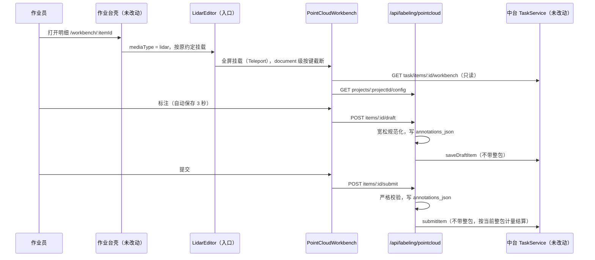

# 点云作业台一期交付说明

| 项 | 内容 |
|----|------|
| 文档编号 | PCD-DELIVERY-001 |
| 版本 | V1.0 |
| 日期 | 2026-10-22 |
| 读者 | 项目负责人、伙伴模块开发者、测试 |
| 代码 | `leightonlabs/annotation-platform` 分支 `ccr-1e1b8e6c-6vsh3k` |

---

## 1. 交付概要

1. **点云作业台已作为独立模块交付**：前端全部位于 `labeling-admin-web/src/workbench/editors/lidar/`，后端全部位于新包 `com.pmsm.zs.labeling.pointcloud`，另有一份只新增表的迁移脚本。
2. **未修改任何其它模块**：相对导入基线 `406cf9c`，本分支的净改动只涉及上述点云路径（42 个文件）。分支早期提交 `56d3a52`、`35f5883` 曾改动作业台壳、中台校验、导出作业与公共文档，已在 `0931aef` 中全部还原；合并时请按**净差异**审阅（或压缩合并）。
3. **一期功能闭环**：打开任务 → 拉框 / 逐点分割 → 自动保存与本机暂存 → 提交校验 → 质检提问题、修改、通过 / 驳回 → 返工 → 导出点云训练包。
4. **验证**：前端单测 24 项、后端单测 15 项全部通过；前端生产构建通过；在真实路由与作业台壳下做了浏览器冒烟（后端以模拟接口代替）。与真实数据库、对象存储的联调待环境（[07 §8](./07-研发规范与一期计划.md#8-一期排期建议需项目经理确认) W1–W2）。

### 1.1 提交记录（annotation-platform）

| 提交 | 说明 |
|---|---|
| `56d3a52` | 一期首版：解析、编解码、三维编辑器（当时挂在壳内并改动了共享模块） |
| `35f5883` | 共享文档中的点云说明（已还原，内容并入本文 §2–§4） |
| `0931aef` | **模块独立改造**：还原全部共享模块改动；新增独立作业台、点云后端包、配置表、训练包导出 |
| `7e4ebd1` | 导出语义 id 去重：自动编号跳过显式 `categoryId`；编号超过 65535 时导出失败 |

## 2. 交付清单

### 2.1 前端 `labeling-admin-web/src/workbench/editors/lidar/`

| 文件 | 行数 | 职责 |
|---|---|---|
| `LidarEditor.vue` | 32 | 入口：保持壳原有 props / emits 约定，全屏挂载点云作业台（不向壳回写任何结果） |
| `PointCloudWorkbench.vue` | 1154 | 独立作业台：任务加载、类别栏、对象 / 属性 / 问题面板、自动保存与本机暂存、撤销、提交、质检、上下条、项目工具、页面级快捷键 |
| `PointCloudEditor.vue` | 1567 | 三维编辑器：目标模式、分割模式、显示控制、提交前校验 |
| `ThreeViewPanel.vue` | 421 | 俯视 / 侧视 / 后视三视图：拖边（对边不动）、平移、旋转 |
| `pointCloudScene.ts` | 433 | three.js 场景：着色器点（隐藏点 alpha = 0）、立体框、手柄、视角、拾取 |
| `pointCloudFormats.ts` | 642 | PCD / PLY / KITTI BIN / LAS / NPY 解析、LZF 解压、点序摘要 |
| `pointLabels.ts` | 136 | `rle-varint-v1` 编解码、点数统计、调色板重映射 |
| `cloudGeometry.ts` | 248 | 框内点、贴合、地面估计、投影与选区、角度规范化 |
| `cloudColors.ts` | 135 | 高度 / 强度 / RGB / 类别着色 |
| `lidarValidation.ts` | 110 | 提交前校验（硬错误 / 提醒） |
| `pointCloudTypes.ts` · `pointCloudResult.ts` | 96 · 202 | 点云结果模型与 `lbl-v1` 往返（保留未知字段与非立体框图形） |
| `pointCloudHistory.ts` | 54 | 撤销 / 重做（整帧快照，50 步） |
| `pointCloudApi.ts` | 94 | `/api/labeling/pointcloud/**` 调用 |

旧的 `lidarScene.ts`、`pcdParse.ts`（原 LidarEditor 的辅助文件，只被该目录使用）已由上表文件取代并删除。

### 2.2 后端 `com.pmsm.zs.labeling.pointcloud`

| 文件 | 行数 | 职责 |
|---|---|---|
| `controller/PointCloudController` | 180 | 草稿、提交、质检保存、通过、驳回、作业配置读写、训练包下载 |
| `service/PointCloudService` · `impl/PointCloudServiceImpl` | 91 · 273 | 校验后写整包，再调用 `TaskService` 流转（同一事务） |
| `support/PointCloudResultValidator` | 316 | 草稿宽松规范化、提交严格校验（[03 §7](./03-标注结果协议.md#7-校验规则)） |
| `support/PointSegCodec` | 120 | `rle-varint-v1` Java 实现 |
| `support/PointCloudModes` | 140 | 类别作业方式解析与判断 |
| `support/PointCloudExportWriter` | 319 | 点云训练包（[03 §9](./03-标注结果协议.md#9-点云训练包)） |
| `domain/**`、`mapper/LblPcProjectConfigMapper` + `resources/mapper/pointcloud/*.xml` | — | 请求 / 返回对象、配置表实体与 Mapper |
| `docs/数据库/labeling_pointcloud_migrate.sql` | 13 | 新建 `lbl_pc_project_config`（幂等） |

### 2.3 测试

| 端 | 文件 | 用例 |
|---|---|---|
| 前端 | `tests/pointcloud/pointCloudFormats.test.ts` | 仓库样例 PCD；PCD ascii（NaN 占位、强度、rgb）/ binary / binary_compressed；LZF；PLY；KITTI BIN；LAS；NPY；大坐标平移与摘要 |
| 前端 | `tests/pointcloud/pointLabels.test.ts` | 编解码往返、空点云、截断与点数不符、调色板重映射；框内点、贴合、地面估计、投影与选区 |
| 前端 | `tests/pointcloud/lidarValidation.test.ts` | 合法结果；几何 / 作业方式 / 跟踪 ID / 必填属性；条件属性；提醒与分割类别检查 |
| 前端 | `tests/pointcloud/pointCloudResult.test.ts` | 解析与保留未建模字段；序列化往返；非法 JSON |
| 后端 | `PointSegCodecTest` | 与前端相同的测试向量；损坏与点数不符 |
| 后端 | `PointCloudResultValidatorTest` | 严格校验保留全部字段并回写类别名；各类拒绝；条件必填；草稿宽松与作业方式往返 |
| 后端 | `PointCloudExportWriterTest` | 框 / 语义标签 / 报告；语义 id 去重与越界；无可导出与重名 |
| 后端 | `PointCloudServiceImplTest` | 提交先写结果再流转且不带整包；校验失败不流转；质检保存覆盖顺序；通过 / 驳回不带整包；草稿交由中台校验持有人 |

运行方法见 [07 §3.1](./07-研发规范与一期计划.md#31-提交前必须通过)。

## 3. 实现要点

### 3.1 与平台的衔接方式



- **按键隔离**：作业台在 `document` 上监听按键并始终 `stopPropagation()`，壳挂在 `window` 上的快捷键收不到点云页面的按键。
- **结果隔离**：入口组件从不向壳发出 `update:snapshot` / `dirty`，壳没有可保存的内容，不会调用通用保存 / 提交接口（浏览器冒烟中计数为 0）。
- **事务**：点云服务方法 `@Transactional`，写整包与中台流转同成同败；中台校验失败（如非执行人、状态不对）时整包写入一并回滚。

### 3.2 关键约定

- 逐点标签下标 = 文件原始点序；`pointSeg.pointCount` / `digest` 必须与 `pointCloud` 一致，否则作业台禁止分割编辑与提交、后端拒绝提交。
- `rle-varint-v1`：按 (值, 游程) 写 LEB128 变长整数后 base64；前后端用同一组测试向量校验。
- 立体框 `center` 为几何中心、原始坐标；航向角落库为度（[0, 360)，绕 +Z 逆时针，0 指向 +X）；OpenPCDet 导出换算为弧度 [-π, π)。
- 类别作业方式存 `lbl_pc_project_config.config_json`：`{"classModes":{"<classId>":["cuboid","point_seg"]}}`；未配置的类别默认只拉立体框。

## 4. 验证记录

### 4.1 自动化

| 检查 | 结果 |
|---|---|
| 前端单测（Node 22，内置 test runner） | 24 / 24 通过 |
| 后端单测（`mvn test`，点云包） | 15 / 15 通过 |
| 前端生产构建（`vue-tsc -b && vite build`） | 通过 |

### 4.2 浏览器冒烟（真实路由 + 作业台壳，模拟后端）

| 场景 | 结果 |
|---|---|
| 打开 `lidar` 明细 | 点云作业台全屏接管；点数、类别、对象列表正确 |
| 壳按键隔离 | 按 Enter、→、`[`、`h`、`n` 不跳转、不提交；壳的 `/task/items/:id/(draft|submit|accept|reject|review-notes)` 调用次数为 0 |
| 拉框与属性 | 新建框；必填属性缺失时提交被阻止并列出；在右栏补填后通过 |
| 分割与撤销 | 矩形赋类、撤销、重做后统计正确 |
| 自动保存与提交 | 停手 3 秒调用草稿接口；提交后进入队列下一条 |
| 质检驳回 | 对框提问题后驳回，驳回理由为“框不准（第 1 个框）：…”；立体框 `trackId`、`size` 保留 |
| 项目工具 | 保存类别作业方式（PUT 配置）后类别栏立即更新；导出下载 zip |

### 4.3 性能（研发机，无头浏览器软件渲染，仅作参考）

| 场景 | 结果 |
|---|---|
| 200 万点 KITTI BIN 加载（解析 + 上屏） | 约 1.3 s |
| 200 万点套索选区 | 约 1.5 s |
| 合成车载场景约 19 万点，贴合一辆车 | 4.40 × 1.80 × 1.51 m，航向 8.6° |

目标作业电脑上的实测在 W3 进行。

## 5. 已知问题与限制

| # | 问题 / 限制 | 处理 |
|---|---|---|
| L1 | 解析在主线程进行，数百万点 ASCII 文件加载时界面短暂无响应 | 二期移到 Web Worker |
| L2 | 选区穿透被遮挡点 | 操作规范约束（[05 §2](./05-作业台设计与操作规范.md#2-模式与工具)）；二期评估可见点选区 |
| L3 | 训练包同步生成、在内存中打包 | 按数据集分批导出；大规模交付前接入异步导出作业（[07 §7 J5](./07-研发规范与一期计划.md#7-与伙伴模块的对接事项)） |
| L4 | 导出按项目**当前**钉定的规范版本取类别，类别已停用的历史立体框不导出 | 交付前确认规范版本；如需按任务冻结版本导出，二期调整 |
| L5 | 撤销历史只在当前样本内有效，切换样本后清空 | 设计如此 |
| L6 | 项目工具只能从作业台进入，需先有该项目的明细 | 伙伴事项 J1 可提供独立入口；一期由管理员从任务详情打开任一明细 |
| L7 | 纯分割项目结算需在费率中只设按条单价 | [04 §1](./04-项目规范配置.md#1-建项目)；伙伴事项 J4 |
| L8 | 无整帧属性、无批量改类 | 二期作业台增强 |

## 6. 给伙伴的替换文本

对接事项 J7：`labeling-server/docs/测试数据/README.md` 第 13 节仍描述旧版编辑器。建议由文档维护人替换为：

```markdown
### 13. 点云立体框 / 逐点分割（可测）

**项目**：媒体「点云」，类型「立体框 / 点云」
**数据**：`13_点云/13_点云.zip`（ASCII PCD）
**前置**：已执行 `docs/数据库/labeling_pointcloud_migrate.sql`

**操作**：

1. 打开明细后进入全屏的“点云作业台”（壳的快捷键在此页面不生效）
2. **视角**：左键旋转、右键平移、滚轮缩放；`F` 适应，`G` 俯视
3. **新建框 C**：在地面拖出底面；**选择 V** 后用 `T` 平移 / `R` 旋转手柄、三视图拖边、方向键微调；`A` 贴合，`U` 掉头
4. **属性**：右栏“对象”中填写；必填未填时提交会被阻止
5. **分割**（需在顶栏“项目工具”中给类别勾选“逐点分割”）：`M` 切换模式，`L` 套索 / `R` 矩形 / `B` 笔刷
6. `Ctrl+S` 保存，`Ctrl+Enter` 提交；重开可还原。结果中立体框为 `type:"cuboid"` + `center` / `size` / `yaw`，分割层为根字段 `pointSeg`
7. 详细说明见点云平台仓库 docs/05-作业台设计与操作规范.md
```

## 7. 下一步

| 顺序 | 事项 | 负责 | 对应 |
|---|---|---|---|
| 1 | 与伙伴确认对接事项 J1–J8，重点 J2（影响图像模块）、J3、J4 | 点云负责人 + 各模块负责人 | [07 §7](./07-研发规范与一期计划.md#7-与伙伴模块的对接事项) |
| 2 | 协议评审会：02 / 03 / 04 | 项目经理 | W1 |
| 3 | 准备联调环境：执行迁移脚本、调整 §4 参数、对象存储 CORS | 运维 + 研发 | [07 §4](./07-研发规范与一期计划.md#4-部署与配置) |
| 4 | 索取两类真实样本与期望交付样例，完成格式与坐标适配 | 项目经理 + 研发 | W1–W2 |
| 5 | 全链路联调与目标硬件性能测试，按 TC-01–TC-25 自测 | 研发 | W2–W3 |
| 6 | 编写操作手册（以 05、06 为底稿），组织试标 | 项目经理 | W3–W5 |
