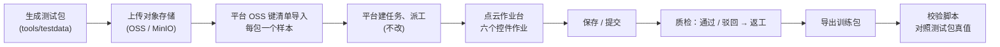

# 点云作业台重构与标注控件开发计划

| 项 | 内容 |
|----|------|
| 文档编号 | PCD-PLAN-002 |
| 版本 | V2.0 |
| 日期 | 2026-10-23 |
| 依据 | [2026-10-23 点云平台待确认问题（需求调整）](./讨论记录/2026-10-23-点云平台待确认问题-需求调整.md)；参考页面 `4D点云分割作业平台结构.html`（仓库根目录）；annotation-platform 当前代码 |
| 取代 | [07 §8 一期排期](./07-研发规范与一期计划.md#8-一期排期建议需项目经理确认)、[07 §9 路线图](./07-研发规范与一期计划.md#9-路线图)，以及 09 V1.0 中的“二期：序列与效率”计划 |
| 约束不变 | 只开发点云作业相关内容，不修改其它工作台与平台中与点云无关的模块（[07 §1](./07-研发规范与一期计划.md#1-模块边界与合并约定)） |

---

## 0. 变更摘要

| 项 | 原计划 | 新计划 |
|---|---|---|
| 下一步重点 | 一期收尾后做“序列与效率” | **先重构点云作业台并形成可测试的作业链路**，再按六个标注控件推进 |
| 作业单元 | 一个样本 = 一帧点云；作业台内上一条 / 下一条切换 | **一个样本 = 一个任务包（一包多帧，含相机与标定）**；作业台内只切帧，不切包 |
| 页面结构 | 一期自定的三栏布局 | 参照参考页面：左侧类型面板、浮动工具条、右侧竖向工具栏、相机面板、场景属性、帧导航与帧条；保持现有深色配色 |
| 优先控件 | 立体框、逐点语义（已完成单帧） | 立方体、刷点、3D 框投回图像、车道拓扑、融合与 4D、占用格子，六个控件按依赖分四个阶段完成 |
| 相机联动 | 三期 | 阶段 2 |
| 车道拓扑 | 四期 / 按订单 | 阶段 3 |
| 占用格子 | 四期 | 阶段 4 |
| 规范库 | 用类别与属性，几何不用 | 评估后只用可用部分；不足之处在作业台与点云配置中补足（§3） |
| 快捷键 | 作业台内固定快捷键 | 不使用派工热键；作业台内置可自定义快捷键 + 快捷键列表窗口（§4） |

一期已完成的单帧能力（解析、编码、几何、渲染、校验、点云接口、训练包）作为底座保留，在新作业台中复用（§10 阶段 0）。

## 1. 需求理解与假设

| # | 需求 | 理解 | 需要确认的假设 |
|---|---|---|---|
| R1 | 点云作业页面完全重构 | 参照参考页面的结构与功能重做页面；以实际功能为准取舍；实际数据是“一包多帧”且包很大，作业台内不做包间切换 | “风格色彩保持和原来相似”指保持现有点云作业页面的深色配色（底色 `#0f172a` / 面板 `#1e293b` / 强调 `#38bdf8`），平台原点云编辑器也是这套配色 |
| R2 | 规范库功能评估 | 只用可用功能，不改规范库；不足在作业台中完善 | — |
| R3 | 派工时配置的作业台热键 | 不使用；作业台内设置快捷键，并提供快捷键列表窗口 | — |
| R4 | 先实现作业台并形成可测试链路；优先六个控件 | 新计划第一阶段交付可被测试人员端到端测试的作业台；六个控件按依赖顺序排期 | 六个控件均需交付；顺序可按首个合同调整 |

## 2. 参考页面分析

参考页面为某量产 4D 点云分割工具的静态快照（无脚本，三维画布内容未保存），可还原出完整的页面结构。

### 2.1 结构

```text
┌ 顶栏：当前项目 · 数据集ID · 当前帧(时间戳) ⓘ ………… [合并帧|单帧] · 点数统计 · 有效数据集 · 有效帧 · 保存 · 提交 ┐
├ 左栏「类型」[筛选/排序] ┬ 浮动工具条：框选 圈选 自由绘制 折线 | 添加区域 移除区域 | 点云筛选 | 3D测距(D) ┬ 渲染点数 199万/200万 ⚙ ┤
│ 总计 10,764,901 👁 🔒   │                                                                   │ 右侧竖向工具栏：          │
│ ▶ ● 反射噪声  👁 🔒      │      三维画布（点云）                                               │  顶视角 相机数据 场景属性   │
│ ▶ ● 地面      👁 🔒      │      浮动面板「相机数据」：6 路缩略图（前视、后视、4 路鱼眼），可放大 │  三视图 旋转方向 工具操作说明│
│ ▼ ● 建筑物    👁 🔒      │      弹窗「选择标注类型」：搜索 + 类别列表                          │  ───────────────          │
│    28 静 总92,692 👁 ⌖ 🗑 🔒│      底部浮动「场景属性」：天气 时间 道路状况 停车环境 路面材质 …     │  点云大小 亮度 自定义高度过滤│
│    29 静 总157,761 …      │                                                                   │  强度渲染 辅助线          │
│ …（约 40 个类别）        │                          ‹ 1 / 33 帧 ›                            │  质检列表（可展开）        │
└ 帧条：1 2 3 … 33（每格提示“有效帧”，带质检标记）──────────────────────────────────────────────────────────────┘
```

### 2.2 功能取舍

| 区域 | 参考页面功能 | 采纳 | 新作业台中的做法 |
|---|---|---|---|
| 顶栏 | 项目 / 数据集 / 当前帧时间戳 | 采纳 | 任务名、任务包编号、当前帧序号与时间戳 |
| 顶栏 | 合并帧 / 单帧 | 采纳（阶段 2） | 需要位姿，属于“融合与 4D”；没有位姿的包只显示单帧 |
| 顶栏 | 有效数据集 / 有效帧 | 采纳 | 包级、帧级“有效 / 无效”标记，无效帧不参与校验与导出 |
| 顶栏 | Label 点数统计 | 采纳 | 统计弹窗：各类点数、各帧点数、未标注 |
| 顶栏 | 保存 / 提交 | 采纳 | 质检阶段换为“驳回 / 通过”；不提供包间队列切换 |
| 左栏 | 类型列表：颜色、显隐、锁定、总点数；可展开实例（编号、静 / 动、点数、显隐、定位、删除、锁定）；筛选 / 排序 | 采纳 | 按当前控件列出类别；“锁定”替代一期的“仅改未标注”，可按类、按实例锁定；实例列表在阶段 2 随轨迹 / 实例上线 |
| 工具条 | 框选、圈选、自由绘制、折线选 | 采纳 | 刷点控件的四种选区；折线选按设定宽度选沿线的点（路沿、车道线点） |
| 工具条 | 添加区域 / 移除区域 | 采纳 | 选区的“并入 / 扣除”模式 |
| 工具条 | 点云筛选 | 采纳 | 按类别、高度、强度过滤显示，被过滤的点不参与选区 |
| 工具条 | 3D 测距（D） | 采纳 | 两点距离，显示空间 / 水平 / 垂直三个分量 |
| 画布 | 选择标注类型弹窗（搜索） | 采纳 | 选区完成后弹出，输入文字过滤、回车确认；解决类别多于 10 个时数字键不够用的问题 |
| 画布 | 渲染点数 / 上限设置 | 采纳 | 渲染点数上限可设（默认 200 万），超出时只降采样显示，标注始终作用于原始点 |
| 右侧工具栏 | 顶视角、三视图、旋转方向、相机数据、场景属性、工具操作说明 | 采纳 | “工具操作说明”即快捷键列表窗口（§4） |
| 右侧工具栏 | 点大小、亮度、自定义高度过滤、强度渲染、辅助线 | 采纳 | 辅助线：地面网格、距离圈、坐标轴 |
| 浮动面板 | 相机数据（多路缩略图、放大、关闭） | 采纳（阶段 1 显示图片，阶段 2 叠加投影） | 3D 框投回图像控件的载体 |
| 浮动面板 | 场景属性（多个下拉） | 采纳 | 字段来自规范库“共用属性（作用范围：整图）”，存为包级属性（§3） |
| 底部 | 帧导航（‹ n / N 帧 ›）与帧条 | 采纳 | 帧条标注状态：有效 / 无效、已标注、有质检问题、当前帧；虚拟滚动支持数百帧 |
| 右侧 | 质检列表（可展开） | 采纳 | 列出全包问题，点击跳到对应帧与对象 |
| 画布 | 编辑模式提示（“进入编辑（新增）模式”） | 采纳 | 工具切换提示 |

## 3. 规范库可用性评估

评估对象：平台“规范库”（本体）的类别、属性、版本能力，以及作业台接口 `getTaskWorkbench` 返回的 `classes` 与 `attributes`。

| 规范库功能 | 评估 | 点云作业台的用法 | 不足与补足（均在点云模块内） |
|---|---|---|---|
| 类别：名称、颜色、停用 | 可用 | 类型面板、着色、校验 | — |
| 类别：英文名、导出码、基准编号 | 可用 | 导出类名与语义 id | — |
| 类别：超类、父类 | 可用 | 类型面板分组（可选） | — |
| 本类属性：单选 / 多选 / 文本 / 数字、必填、一层条件显示、一层子属性 | 可用 | 对象属性表单与校验 | 不区分“轨迹级”与“帧级”属性 → 在点云配置中为属性标注作用层级 |
| 共用属性（作用范围：整图 / 类别） | 可用 | 整图范围的共用属性 → 场景属性面板（包级）；类别范围的共用属性 → 所有类别通用 | 帧级场景属性需要时在点云配置中标注 |
| 版本发布、对比、项目钉定、任务冻结 | 可用 | 作业时按任务冻结版本取类别与属性 | 导出改为按任务冻结版本（阶段 1） |
| 类别几何（点云媒体只有立体框、点、多边形、整图分类） | **不可用于区分控件** | 不读取 | 点云配置“类别控件”：立方体、刷点、车道中心线、信号灯、占用格子（一期“类别作业方式”的扩展） |
| 骨架 | 暂不需要 | 不读取 | 关键点控件上线时再评估 |
| 关系定义 | **无** | — | 车道拓扑的关系类型（车道连接、左右相邻、灯控车道）由作业台内置，可在点云配置中启停 |
| 占用状态、运动状态 | **无** | — | 占用格子的“空 / 占 / 未知”“静止 / 运动”由作业台内置为固定枚举 |
| 类别热键 | **无** | — | 作业台快捷键（§4） |
| 项目标注类型 | 可用（仅结算） | 点云项目统一选“立体框 / 点云” | 结算单位见 §8.3 |

**结论**：规范库可用，不修改；类别、属性、版本全部沿用。控件类型、关系类型、占用状态、快捷键等规范库没有的内容，放在点云作业配置（`lbl_pc_project_config`）和作业台中完善。

## 4. 快捷键方案

### 4.1 派工热键评估

平台在项目和任务上各存一份“作业台类别热键”（`workbench_class_pins_json`），只支持 1–9、0 共 10 个槽位，每个槽位绑定一个类别，任务级覆盖项目级。它只能切换类别，数量受限，且无法覆盖点云的视图、帧、工具操作。**结论：点云作业台不读取派工热键**，也不修改该功能。

### 4.2 作业台快捷键

| 能力 | 做法 |
|---|---|
| 默认键位 | 作业台内置一套默认键位（§4.3） |
| 自定义 | “快捷键”窗口中可改键；同一作用域内冲突即时提示；不允许占用浏览器保留键（如 `Ctrl+R`、`Ctrl+W`、`F5`）；可恢复默认；按用户保存在浏览器本机（后续可存服务器） |
| 列表窗口 | 右侧工具栏“工具操作说明”按钮与 `?` 键打开，按“通用 / 视图 / 帧 / 各控件”分组列出键位与鼠标操作，可搜索 |
| 类别选择 | 当前控件下前 10 个类别对应 1–9、0；更多类别用“选择标注类型”弹窗（`/` 打开或选区完成后自动弹出）搜索选择 |
| 作用域 | 通用键全局有效；控件键只在该控件激活时有效，不同控件可复用同一个键 |
| 隔离 | 输入框聚焦或弹窗打开时不响应；页面级截断，作业台壳的按键不生效（沿用一期做法） |

### 4.3 默认键位（初稿，以作业台内列表为准）

| 作用域 | 默认键位 |
|---|---|
| 通用 | `Ctrl+S` 保存；`Ctrl+Z` 撤销；`Ctrl+Y` / `Ctrl+Shift+Z` 重做；`Ctrl+Enter` 提交 / 通过；`?` 快捷键列表；`Esc` 取消当前操作 / 取消选中；`Delete` 删除选中；`1`–`9`、`0` 类别；`/` 搜索类别；`H` 隐藏 / 显示选中对象 |
| 控件切换 | `Alt+1` 立方体；`Alt+2` 刷点；`Alt+3` 车道；`Alt+4` 占用格子 |
| 帧 | `,` 上一帧；`.` 下一帧；`Home` / `End` 首 / 末帧；`Ctrl+M` 合并帧 / 单帧 |
| 视图 | `T` 顶视角；`F` 适应 / 聚焦选中；`V` 三视图；`C` 相机面板；`P` 投影开关；`R`（按住拖动）旋转方向；`D` 3D 测距 |
| 立方体 | `N` 新建；`A` 贴合点云；`U` 掉头；方向键平移、`PgUp` / `PgDn` 升降（`Shift` 加速）；`Z` / `X` 旋转；`Ctrl+C` / `Ctrl+V` 复制到下一帧；`I` 关键帧插值 |
| 刷点 | `B` 框选；`Q` 圈选；`E` 自由绘制；`L` 折线选；`+` / `-` 添加 / 移除区域；`[` / `]` 笔刷大小；`K` 锁定当前类 |
| 车道 | `N` 新建中心线；`J` 连接；`G` 灯控关系；`S` 拆分；`M` 合并；`Shift+R` 反向 |
| 占用格子 | `Shift+↑` / `Shift+↓` 切换高度层；`B` 框选格子；`E` 刷格子；`Shift+1` / `Shift+2` / `Shift+3` 设为空 / 占 / 未知；`Shift+M` 静止 / 运动 |

## 5. 新作业台设计

### 5.1 作业单元：任务包

| 项 | 规定 |
|---|---|
| 定义 | 一个任务包 = 平台中的一个样本（manifest）= 一条派工明细；包内含多帧点云、可选的多路相机图像、标定与位姿 |
| 登记方式 | 不改平台导入：数据按 §7 目录放到对象存储，用平台既有的“OSS 键清单（CSV）”导入，每包一行，`object_key` 取包内第一帧点云，`manifest_code` 取包编号 |
| 识别 | 作业台打开样本时，点云后端由样本对象键找到包根目录下的 `package.json`，校验后缓存包索引；没有 `package.json` 的旧样本按“单帧包”处理，一期数据可直接打开 |
| 切换 | 作业台内只切帧；包与包之间不切换，提交 / 通过 / 驳回后回到列表，由作业员领取下一包 |

### 5.2 页面布局

```text
┌ 顶栏：← 返回 · 任务名 · 包编号 · 第 12/33 帧（时间戳）· [合并帧|单帧] · 点数统计 · 有效包 · 有效帧 · 保存状态 · 保存 · 提交（质检：驳回原因 · 驳回 · 通过）┐
├ 左栏「类型」──────┬ 浮动工具条：[立方体|刷点|车道|占用] + 当前控件工具 ┬ 渲染点数 n / 上限 ⚙ ┬ 右侧竖向工具栏 ┤
│ 总点数 👁 🔒       │                                              │                   │ 顶视角 三视图    │
│ 类别（按当前控件） │            三维画布                            │ 右栏（可收起）：   │ 相机数据 场景属性│
│ ▶ ● 名称 点数 👁 🔒 │  浮动面板：相机数据（多路，阶段 2 叠加投影）    │  对象属性 / 轨迹 /│ 旋转方向 快捷键  │
│   └ 实例 / 轨迹     │  浮动面板：三视图（选中立方体）                │  关系 / 质检列表   │ ───────────    │
│                    │  弹窗：选择标注类型（搜索）                    │                   │ 点大小 亮度      │
│                    │  底部浮动：场景属性                            │                   │ 高度过滤 强度    │
│                    │                ‹ 12 / 33 帧 ›                 │                   │ 辅助线           │
└ 帧条：1 2 3 … 33（有效 / 无效 · 已标注 · 质检问题 · 当前帧；虚拟滚动）────────────────────────────────────────────┘
```

| 区域 | 内容 |
|---|---|
| 顶栏 | 只放“全包级”的状态与动作；没有上一包 / 下一包 |
| 左栏 | 当前控件可用的类别（来自规范库 + 类别控件配置）：颜色、名称、点数或对象数、显隐、锁定；可展开实例 / 轨迹 |
| 浮动工具条 | 左侧选控件，右侧为该控件的工具；选区类工具带“添加 / 移除区域”与“点云筛选” |
| 右栏 | 选中对象的属性（规范库属性）、轨迹列表（阶段 2）、车道关系（阶段 3）、质检列表；可收起 |
| 右侧竖向工具栏 | 视图与显示调节，与参考页面一致 |
| 帧导航与帧条 | 切帧、帧状态一览；切帧不丢未保存内容 |

### 5.3 加载与性能

| 策略 | 说明 |
|---|---|
| 先索引后数据 | 打开时只取包索引（帧清单、传感器、标定），首帧点云与图片随后加载 |
| 预取与缓存 | 预取当前帧前后各 2 帧；按内存预算（默认 1.5 GB）淘汰最久未用的帧 |
| Worker | 点云解析、选区计算、占用格子生成放到 Web Worker，主线程只渲染与交互 |
| 渲染预算 | 渲染点数上限可设（默认 200 万）；合并帧等超量场景按体素降采样显示，标注写回原始点 |
| 按帧保存 | 只保存改动过的帧；包级数据（轨迹、车道、关系、场景属性）单独保存 |
| 签名地址 | 包内文件由点云后端批量签发地址，过期自动刷新 |

### 5.4 视觉风格

保持现有点云作业页面的深色配色：页面底色 `#0f172a`、面板 `#1e293b`、正文 `#e2e8f0`、次要文字 `#94a3b8`、强调 `#38bdf8`、警告 `#fbbf24`、错误 `#f87171`；表单与弹窗沿用 Element Plus。参考页面只借鉴结构，不照搬其配色。

### 5.5 与平台的边界（不变）

- 入口仍是作业台壳按 `lidar` 挂载的 `LidarEditor.vue`，壳侧零改动；点云页面全屏覆盖。
- 读写只经 `/api/labeling/pointcloud/**`；状态流转、权限、结算调用平台 `TaskService`（不改）。
- 新增表只追加到 `labeling_pointcloud_migrate.sql`。

## 6. 标注控件设计

### 6.1 立方体

| 项 | 设计 |
|---|---|
| 用途 | 在点云里画立方体，记录中心、长宽高和航向，单位米 |
| 作业 | 顶视角拖出底面或三点法（两点定朝向、一点定宽）新建；贴合点云；三视图拖边与旋转；数值编辑；掉头；方向键微调 |
| 多帧 | 立方体属于轨迹（`trackId`）；复制到下一帧并可自动贴合；两关键帧之间插值（中心与尺寸线性、航向取最短弧）；刚体可“锁定尺寸”使全轨迹一致 |
| 属性 | 类别与轨迹级属性存在轨迹上；遮挡等帧级属性存在每帧的框上 |
| 校验 | 几何有效；类别属于立方体控件；同帧 `trackId` 唯一；轨迹类别一致；锁定尺寸的轨迹尺寸一致；轨迹断档、框内点过少为提醒 |
| 导出 | 每帧 OpenPCDet 文本 + 跟踪 JSON（帧、轨迹、框） |
| 现状 | 单帧能力已完成（一期），阶段 1 迁入新页面，阶段 2 补多帧 |

### 6.2 刷点

| 项 | 设计 |
|---|---|
| 用途 | 在点云上涂点，每个点一个类别；立体框不能代替逐点的类 |
| 作业 | 框选、圈选、自由绘制（笔刷）、折线选；添加 / 移除区域；完成选区后弹出“选择标注类型”；点云筛选限定可选范围 |
| 保护 | 按类别、按实例锁定，被锁定的点不会被改写；全局“只改未标注”作为一个快捷开关保留 |
| 多帧 | 单帧逐帧标注（阶段 1）；合并帧模式下一次选区作用于所有帧对应的原始点（阶段 2，需位姿）；实例编号与静 / 动状态（阶段 2） |
| 统计 | 各类点数、未标注点数（全包 / 当前帧）；点数统计弹窗 |
| 校验 | 标签绑定点序摘要；用到的类别属于刷点控件；未标注点为提醒 |
| 导出 | 每帧 SemanticKITTI `.label`（实例上线后写高 16 位） |
| 现状 | 单帧能力已完成（一期），阶段 1 迁入新页面并增加圈选、折线选、添加 / 移除区域、锁定、类型弹窗 |

### 6.3 3D 框投回图像

| 项 | 设计 |
|---|---|
| 用途 | 用标定把点云里的框投回相机画面，核对是不是同一个目标；是计算，不是再画新框 |
| 作业 | 相机面板显示当前帧各路图像；打开投影后，所有立方体以 12 条边的线框投到图像上（颜色按类别、标注轨迹号），选中框高亮；在图像中点击线框即选中对应立方体 |
| 计算 | 立方体 8 个角点 → 雷达坐标 → 相机坐标（外参）→ 像平面（内参与畸变：针孔 + OpenCV 畸变、鱼眼 Kannala–Brandt）；相机背后的部分在相机坐标系中裁剪；有位姿和相机时间戳时按时间差做运动补偿 |
| 标定检查 | 可把点云按深度着色投到图像上，检查标定是否对齐；发现偏差时对该包提“标定异常”问题，不修改标定 |
| 结果 | 不产生标注数据；只有质检问题会被保存 |
| 依赖 | 包内的相机图像、内外参、畸变模型（§7） |

### 6.4 车道拓扑

| 项 | 设计 |
|---|---|
| 用途 | 除了车道中心线本身，还要标线与线怎么连，以及哪盏灯管哪条车道 |
| 元素 | 车道中心线：三维折线，点序即行驶方向；信号灯：用立方体控件标注（类别配置为“信号灯”）；可扩展停止线、车道边界 |
| 关系 | `successor`：A 的终点接 B 的起点；`left_neighbor` / `right_neighbor`：相邻车道；`controls`：信号灯 → 车道 |
| 作业 | 在顶视角（有位姿时用合并帧）沿车道画中心线，顶点自动贴地；顶点增删移动、拆分、合并、反向；连接工具从 A 终点拖到 B 起点，端点相距小于阈值时给出连接建议；灯控工具先选灯再点选车道；关系在画布上以箭头与连线显示，右栏列出关系清单 |
| 坐标 | 有位姿时车道与关系存在世界坐标、全包共享，切帧时同一位置显示；无位姿时只在当前帧 |
| 校验 | 折线至少 2 个点；连接两端距离不超过阈值；关系引用的对象存在；信号灯至少控制一条车道（提醒）；孤立车道（提醒） |
| 导出 | 车道与关系 JSON（中心线点列、关系表）；甲方格式（如 OpenLane-V2 风格）按导出写出器开发 |

### 6.5 融合与 4D

| 项 | 设计 |
|---|---|
| 用途 | 把连续帧、鸟瞰图和多个传感器上的结果对到同一条轨迹，或同一片区域 |
| 连续帧 | 帧条与帧导航；轨迹面板（轨迹号、类别、出现帧、关键帧）；复制、插值、合并 / 拆分轨迹、重新编号；跨帧检查（同号不同类、尺寸突变、断档） |
| 鸟瞰 | 正交顶视图，可叠加合并帧；车道、占用格子与静态物体在鸟瞰中作业 |
| 合并帧 | 按位姿把多帧点云变换到世界坐标叠加显示；动态目标可按轨迹框剔除；刷点在合并帧中的结果按点来源写回各帧 |
| 多传感器 | 一帧多个雷达：按外参合到同一坐标，标签按原始文件分别保存；相机：投影中显示同一轨迹号，核对跨传感器一致 |
| 同一片区域 | 车道、静态占用等静态要素在世界坐标中标一次，全包各帧共用 |
| 依赖 | 包内的帧时间戳、位姿（自车 → 世界）、雷达外参（§7） |

### 6.6 占用格子

| 项 | 设计 |
|---|---|
| 用途 | 把空间划成格子，每格标空着、被占或未知，以及静止、运动和类别；不是立体框，也不是逐点涂类 |
| 参数 | 在点云配置中按项目设置：格子边长（如 0.4 m）、范围（如 x / y ±40 m、z −1～5.4 m）、坐标系（每帧自车坐标）、参与的类别 |
| 预生成 | 有点的格子为“被占”，类别取格内点的刷点类别（众数）；从雷达原点沿射线经过的格子为“空”；其余为“未知”；落在运动轨迹框内的格子标“运动”及该类别 |
| 作业 | 鸟瞰按高度层切片编辑，框选 / 笔刷设置状态、类别、静 / 动；三维视图显示被占格子；按状态、类别过滤 |
| 存储 | 每格一个 16 位码（类别 12 位 + 状态 2 位 + 运动 1 位），整块用与刷点相同的 `rle-varint-v1` 编码，按帧保存 |
| 校验 | 网格参数与项目配置一致；被占格子必须有类别；空 / 未知格子不带类别 |
| 导出 | 每帧二进制格子文件 + 元数据 JSON；Occ3D 等格式按导出写出器开发 |

## 7. 任务包目录规范（草案，阶段 1 冻结）

```text
<包根目录>/
├── package.json                         # 包描述（必需）
├── lidar/<帧ID>.pcd                      # 主雷达，每帧一个文件；多雷达时为 lidar_<名称>/<帧ID>.pcd
├── camera/<相机名>/<帧ID>.jpg             # 可选
└── 其它（不读取）
```

```json
{
  "version": "pc-package-v1",
  "packageId": "BDZN_20260812_0001",
  "coordinate": { "unit": "m", "up": "z" },
  "sensors": {
    "lidars": [{ "name": "top", "extrinsic": { "translation": [0, 0, 1.8], "rotation": [1, 0, 0, 0] } }],
    "cameras": [{
      "name": "camera_1", "label": "前视", "model": "pinhole", "width": 1920, "height": 1080,
      "intrinsic": [1000.0, 1000.0, 960.0, 540.0], "distortion": [0, 0, 0, 0, 0],
      "extrinsic": { "translation": [1.5, 0, 1.6], "rotation": [0.5, -0.5, 0.5, -0.5] }
    }]
  },
  "frames": [{
    "id": "1773044875900000",
    "timestampUs": 1773044875900000,
    "lidar": { "top": "lidar/1773044875900000.pcd" },
    "cameras": { "camera_1": { "key": "camera/camera_1/1773044875900000.jpg", "timestampUs": 1773044875880000 } },
    "pose": { "translation": [0, 0, 0], "rotation": [1, 0, 0, 0] }
  }]
}
```

| 约定 | 说明 |
|---|---|
| 外参 | 传感器 → 自车坐标；旋转为四元数 `[w, x, y, z]` |
| 位姿 | 自车 → 世界坐标；没有位姿时“合并帧”“世界坐标车道”不可用 |
| 相机模型 | `pinhole`（`distortion` 为 OpenCV `k1 k2 p1 p2 k3`）、`fisheye`（Kannala–Brandt `k1 k2 k3 k4`）；其它模型按项目扩展 |
| 路径 | 文件路径相对包根目录 |
| 导入 | 平台“OSS 键清单”CSV：`object_key,manifest_code,media_type`，每包一行：`<包根目录>/lidar/<第一帧>.pcd,<packageId>,lidar` |
| 禁止 | 不要用平台的 zip 导入点云包：它会把每帧拆成一个样本并丢弃图像与标定 |

## 8. 结果存储与协议扩展（草案，阶段 1 冻结）

### 8.1 存储

| 位置 | 内容 |
|---|---|
| `lbl_pc_package`（新表） | 样本 ↔ 包索引缓存：包根目录、描述、帧数、校验时间 |
| `lbl_pc_frame_result`（新表） | 每帧结果：点云绑定、立方体、刷点标签、占用格子、帧级属性、帧状态；带版本号 |
| `lbl_pc_package_result`（新表） | 包级结果：轨迹、车道、关系、场景属性、问题单；带版本号 |
| `lbl_manifest.annotations_json`（平台表，只写） | 包摘要：帧数、有效帧数、已标注帧数、轨迹数，以及供平台计量的 `shapes`（每帧每个立方体一项） |

### 8.2 协议要点

- 每帧结果沿用一期 `lbl-v1` 点云扩展字段（`pointCloud`、`pointSeg`、`cuboid`），新增 `frameIndex`、`occupancy`、`frameAttributes`、`valid`。
- 包级结果新增 `tracks`、`lanes`、`relations`、`sceneAttributes`、`reviewNotes`（带 `frameIndex`）。
- 编码一律沿用 `rle-varint-v1`；新增字段全部可选，一期单帧数据无需迁移。
- 保存带版本号，版本不一致时拒绝并提示刷新，防止多窗口互相覆盖。

### 8.3 结算口径（待确认）

平台按 `annotations_json.shapes` 个数计量“按目标”结算。建议：立方体项目按“每帧每个框”计；纯刷点、占用格子项目费率按条（每包）；车道拓扑按包或按车道条数，合同确定后在摘要中写入对应计数。

## 9. 可测试作业链路

### 9.1 链路



### 9.2 组成

| 组成 | 内容 | 位置 |
|---|---|---|
| 测试包生成器 | 合成多帧场景：地面、建筑、行驶车辆（已知轨迹）、行人、车道（已知拓扑）、信号灯；1 个雷达 + 6 路相机（2 路针孔、4 路鱼眼，由点云渲染出图像）、标定、位姿；同时输出真值与导入 CSV | 本仓库 `tools/testdata/`（Python，仅依赖 numpy） |
| 测试环境 | MySQL + 对象存储（平台已支持的 OSS 或 S3 兼容的 MinIO）+ 后端 + 前端；执行点云迁移脚本 | 部署说明随阶段 1 交付 |
| 测试账号 | 项目管理员、标注员、质检员、审核员各一 | 测试环境 |
| 自动化 | 前后端单测；Playwright 端到端脚本（模拟后端，覆盖作业台全部控件的主路径） | 单测在点云模块内；端到端脚本在本仓库 `tools/e2e/` |
| 导出校验脚本 | 读取导出包与测试包真值，核对帧数、框、标签字节数、车道关系、格子 | 本仓库 `tools/verify/` |
| 测试手册 | 按控件的操作步骤与期望结果 | 本仓库 `docs/` |

### 9.3 各阶段的链路准出

每个阶段结束时，测试人员能在测试环境上用生成的测试包，独立走完 §9.1 全链路，并且该阶段新增控件的用例全部通过、导出校验脚本无差异。

## 10. 分阶段计划

时间为单人研发估算（不含测试组回归），从 2026-10-26 开始；春节（2027-02 上中旬）顺延。

| 阶段 | 内容 | 估时 | 建议时间 | 状态 |
|---|---|---|---|---|
| 阶段 0 | 一期单帧底座：解析、编码、几何、渲染、单帧立方体与刷点、校验、点云接口、训练包 | — | 已完成 | 已完成（[08](./08-一期交付说明.md)） |
| 阶段 1 | 作业台重构 + 任务包 + 快捷键 + 场景属性 + 立方体 / 刷点迁入并增强 + 可测试链路 | 6 周 | 10-26 ～ 12-04 | 待开始 |
| 阶段 2 | 3D 框投回图像 + 融合与 4D（轨迹、复制插值、鸟瞰、合并帧、多雷达、实例与静 / 动） | 6 周 | 12-07 ～ 2027-01-15 | 规划 |
| 阶段 3 | 车道拓扑 | 4 周 | 2027-01-18 ～ 02-26 | 规划 |
| 阶段 4 | 占用格子 | 5 周 | 2027-03-01 ～ 04-02 | 规划 |
| 阶段 5 | 效率与扩展：模型预标、异步导出、质检统计、全景分割、关键点等 | 按需求 | — | 规划 |

### 10.1 阶段 1：作业台重构与可测试链路

| 编号 | 工作包 | 内容 | 估时 |
|---|---|---|---|
| 1-1 | 任务包后端 | `lbl_pc_package` 等新表；读 `package.json`、校验、缓存；批量签发包内文件地址；按帧 / 包级保存与版本校验；包摘要写回 `annotations_json` | 1 周 |
| 1-2 | 页面骨架 | §5.2 布局：顶栏、类型面板、浮动工具条、右侧工具栏、右栏、帧导航与帧条、深色配色；去掉包间队列 | 1 周 |
| 1-3 | 帧加载 | 索引先行、预取、内存预算、Worker 解析、渲染点数上限 | 0.5 周 |
| 1-4 | 立方体迁入 | 一期单帧能力迁入新页面；轨迹号跨帧唯一性检查 | 0.5 周 |
| 1-5 | 刷点迁入与增强 | 圈选、折线选、添加 / 移除区域、点云筛选、按类 / 按实例锁定、类型弹窗、点数统计 | 1 周 |
| 1-6 | 快捷键 | 默认键位、自定义、冲突检查、快捷键列表窗口 | 0.5 周 |
| 1-7 | 场景属性、有效帧 / 包、相机图片显示、3D 测距、辅助线 | 场景属性取规范库整图属性；相机面板先显示图片 | 0.5 周 |
| 1-8 | 质检 | 问题单带帧号；质检列表；帧条问题标记；驳回汇总 | 0.5 周 |
| 1-9 | 可测试链路 | 测试包生成器、导入 CSV、测试环境说明、端到端脚本、导出校验脚本、测试手册；导出升级为多帧并按任务冻结规范取类别 | 1 周（与上面并行） |

里程碑：**M1a（第 3 周末）**：任务包可导入、可在新页面打开并逐帧拉框 / 刷点、保存提交，测试人员可开始走链路；**M1（第 6 周末）**：阶段 1 全部工作包完成，§9.3 准出。

### 10.2 阶段 2：3D 框投回图像 + 融合与 4D

| 编号 | 工作包 | 估时 |
|---|---|---|
| 2-1 | 相机模型与投影（针孔、鱼眼）、线框投影、图像中点选、点云投影检查、标定异常问题 | 1.5 周 |
| 2-2 | 轨迹模型、轨迹面板、复制到下一帧、关键帧插值、锁定尺寸、合并 / 拆分 / 重编号 | 1.5 周 |
| 2-3 | 位姿与合并帧、鸟瞰视图、动态目标剔除、合并帧刷点写回各帧 | 1.5 周 |
| 2-4 | 多雷达合并与分文件标签、实例与静 / 动、跨帧检查、跟踪导出 | 1.5 周 |

### 10.3 阶段 3：车道拓扑

| 编号 | 工作包 | 估时 |
|---|---|---|
| 3-1 | 中心线绘制与编辑（贴地、顶点、拆分合并、反向），世界坐标共享 | 1.5 周 |
| 3-2 | 连接、相邻、灯控关系工具与显示，连接建议，关系清单 | 1.5 周 |
| 3-3 | 校验、导出、测试包车道真值核对 | 1 周 |

### 10.4 阶段 4：占用格子

| 编号 | 工作包 | 估时 |
|---|---|---|
| 4-1 | 网格参数配置、Worker 预生成（被占、射线求空、未知、运动） | 1.5 周 |
| 4-2 | 鸟瞰切片编辑、三维显示、过滤 | 2 周 |
| 4-3 | 编码存储、校验、导出、真值核对 | 1.5 周 |

### 10.5 一期收尾事项的去向

| 事项 | 去向 |
|---|---|
| 测试环境联调、迁移脚本、参数 | 阶段 1（1-9） |
| 真实样本适配 | 拿到样本后插入当前阶段；任务包规范按真实目录结构定稿 |
| 目标硬件性能测试 | 阶段 1 M1 前完成 |
| 操作手册 | 每阶段按控件补充 |

## 11. 待确认事项

| # | 事项 | 默认处理 | 影响阶段 |
|---|---|---|---|
| C1 | “风格色彩与原来相似”是否指现有深色配色 | 按现有深色配色（§5.4） | 1 |
| C2 | 真实任务包的目录、帧数、单帧点数、相机路数与命名、标定与位姿格式 | 按 §7 草案，拿到样本后定稿 | 1 |
| C3 | 首个项目是否是 4D 分割（参考页面默认“合并帧”） | 合并帧在阶段 2；如首个项目需要，提前到阶段 1 后半段 | 1、2 |
| C4 | 刷点是否需要实例编号与静 / 动 | 阶段 2 提供 | 2 |
| C5 | 相机畸变模型（针孔 OpenCV、鱼眼 Kannala–Brandt 之外是否还有其它） | 先支持这两种 | 2 |
| C6 | 车道拓扑的元素与关系清单（是否需要车道边界、停止线、路口区域；信号灯用立方体是否可接受） | 按 §6.4 | 3 |
| C7 | 占用格子参数（格子大小、范围、类别、是否需要相机可见性掩码） | 0.4 m、±40 m、−1～5.4 m，不做可见性掩码 | 4 |
| C8 | 结算口径（§8.3） | 按 §8.3 建议 | 1 |
| C9 | 各控件的交付格式 | 通用格式，甲方格式按导出写出器开发 | 各阶段 |

## 12. 文档更新计划

| 时机 | 更新 |
|---|---|
| 阶段 1 开工前 | [02 数据接入](./02-数据接入规范.md) 增加任务包规范（§7 定稿）；[03 结果协议](./03-标注结果协议.md) 增加包级与帧级结构（§8 定稿）；[04 项目配置](./04-项目规范配置.md) 改为“类别控件”与规范库用法（§3） |
| 阶段 1 结束 | [05 作业台](./05-作业台设计与操作规范.md) 按新页面重写；新增测试手册；[09 开发记录](./09-分阶段开发记录.md) 追加阶段记录 |
| 阶段 2–4 结束 | 03、05 补充对应控件；06 补充对应质检规则；09 追加记录 |
