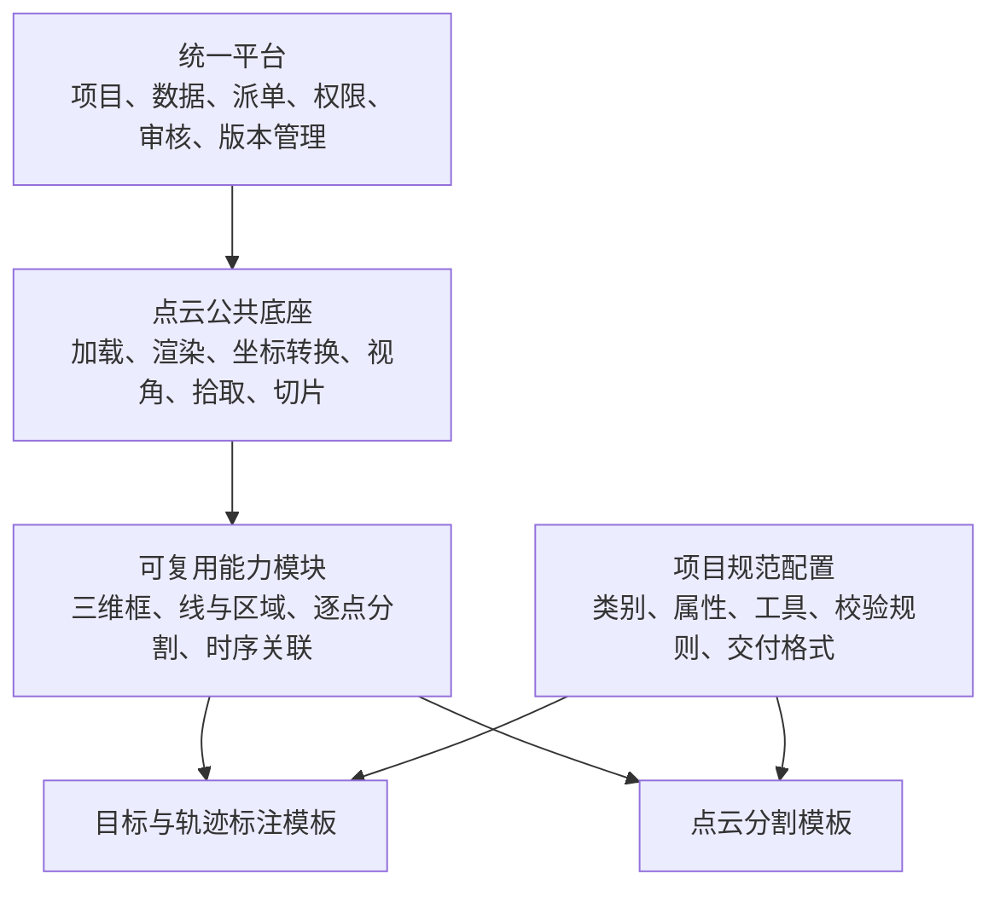

# 首次问答：通用三维点云标注平台如何适配不同甲方需求

- 问答日期：2026-10-19
- 归档日期：2026-10-20
- 记录范围：本次对话的第一次用户提问与完整回答，不含后续关于 Supervisely 的讨论。
- 归档说明：以下保留问答正文、表格、Mermaid 架构图和参考链接；不包含工具执行日志及内部记忆引用元数据。文中的“目前”“首版”等表述均对应原问答时的讨论背景。

## 用户提问

目前要制作一个通用的三维点云数据标注平台。现在面临第一个问题，这个平台要适用于不同的甲方标注需求，比如甲方给出的点云是道路车辆智驾场景，需要以拉三维立体框的形式标注车辆，以折线圈可行驶区域，还要有关联车辆ID等功能。然后另一个甲方给出的要求是点云分割，要求给标注区域内的所有点标注上类型，这时候我的作业界面又要设置分割工具，各种类型列表等内容。虽然标准的数据都是三维点云，但界面和控件功能都会有所不同，你建议如何开发这个平台，要对每个甲方要求都制作一个作业平台吗

## 回答

**不需要为每个甲方重新开发一整套平台。我的建议是：建设一个统一平台，按“标注任务类型”提供不同的作业模板，再通过项目配置和扩展模块满足甲方需求。**

也就是说，你可以有“目标与轨迹标注工作台”和“点云分割工作台”，它们的界面、工具和操作方式可以不同，但共用点云引擎、任务管理、权限、保存、审核等基础能力。

你现在遇到的，本质上是一个需要从一开始就考虑的架构问题：**输入数据都是点云，但标注对象、操作过程和交付结果不同。平台的扩展单位应该是“任务能力”，而不是“甲方名称”。**

先看你举的两个例子：

| 对比项 | 甲方 A：车辆、道路区域、车辆 ID | 甲方 B：点云分割 |
|---|---|---|
| 主要标注对象 | 一辆车、一个道路区域、一条车辆轨迹 | 一批点，以及每个点的类别 |
| 核心工具 | 三维包围框、折线/多边形、跨帧关联 | 点选、框选、套索、刷选、批量赋类别 |
| 主要面板 | 对象列表、对象属性、轨迹列表、时间轴 | 类别列表、类别点数、未标注点统计、分割参数 |
| 核心交付结果 | 框的位置/尺寸/旋转、区域顶点、轨迹 ID | 原始点与类别标签的一一对应关系 |
| 主要质检内容 | 框是否贴合、类别是否正确、跨帧 ID 是否一致 | 范围内是否漏标、类别是否正确、标签与原始点是否对应 |

所以，**仅仅切换工具栏按钮还不够，背后的结果模型、保存方式和质检规则也要跟随任务变化。**

推荐你把平台组织成下面这样：



这里有三个重要的开发边界。

**第一，公共底座尽量复用。** 点云加载、旋转缩放、俯视图/侧视图、颜色显示、高度过滤、空间裁剪、相机联动等能力，可以供不同任务使用。任务领取、自动保存、提交、退回、审核记录等平台能力，也应该共用。

但“公共底座”不意味着所有结果都使用相同的存储结构。例如，两类任务都需要撤销，但移动一个框与给十万个点赋类别，记录撤销的方法就会不同。

**第二，工具按能力开发，工作台按任务组合。** 三维框模块负责创建、移动、缩放、旋转和对象选择；分割模块负责点集合选择、类别赋值、擦除和标签显示；轨迹模块负责跨帧对象关联、关键帧和轨迹检查。工作台模板决定启用哪些模块、如何安排面板、使用哪套操作流程。

这样，第三个甲方如果要求“车辆拉框，同时给地面做分割”，可以在已有能力上组合工作模式。实际作业时，可以切换“对象标注”和“点级分割”模式，避免鼠标操作、选中逻辑和快捷键相互冲突。

**第三，甲方的规范尽量进入项目配置。** 这里的配置不是单纯的页面样式，而是一份完整的“项目标注规范”，包括：

- 使用哪个工作台模板，启用哪些工具和面板。
- 有哪些类别、颜色，以及各类别允许使用哪些标注形状。
- 每类对象有哪些属性，哪些必填，有哪些取值限制。
- 标注范围、忽略区域、漏标检查等质量规则。
- 是否需要跨帧 ID，ID 的作用范围和关联规则。
- 导入、导出采用哪套格式适配器。

例如，同样使用三维框工具，一家甲方可能把车辆分为“小汽车、卡车、公交车”，另一家只区分“机动车、非机动车”。这是类别配置的区别，不应因此新做一个拉框工作台。

判断一项新需求应该怎么处理，可以用这个表：

| 新需求 | 建议处理方式 |
|---|---|
| 增加车型、修改类别颜色、添加“遮挡程度”属性 | 修改项目配置 |
| 已有分割能力，某项目只允许使用套索和刷选 | 修改工具配置 |
| 已有轨迹能力，某项目要求隐藏时间轴 | 修改模板配置 |
| 平台原来只能拉框，现在增加逐点分割 | 开发新的能力模块 |
| 增加一种特殊的道路曲面编辑方式 | 扩展几何和交互模块 |
| 甲方要求一种专有 JSON、二进制标签或目录结构 | 开发导入/导出适配器 |
| 甲方需要独立内网部署、独立数据库 | 单独部署同一套产品，通常无需复制业务代码 |

要保留一个现实边界：**配置只能组合已经实现的能力。新几何、新操作、新算法，仍然需要开发。** 首版不必做复杂的第三方插件系统或微前端，先把模块边界、统一接口和配置结构做好，就能获得主要的复用收益。

你提到的几类结果，底层还需要分别建模，这一点建议尽早确定。

**三维框与车辆身份要分开。** 一个框通常保存中心坐标、长宽高、旋转、类别和属性。每一帧的框有自己的 `annotationId`；连续帧中的同一辆车，通过 `trackId` 关联：

```text
序列 S 中的一辆车：trackId = T008

第 1 帧：annotationId = A101，trackId = T008，框几何 = …
第 2 帧：annotationId = A205，trackId = T008，框几何 = …
第 3 帧：annotationId = A309，trackId = T008，框几何 = …
```

车辆 ID 关联还涉及遮挡、离开后重现、错误关联的拆分与合并，不能只做一个“ID 输入框”。对象的固定属性与逐帧变化的属性，也适合分开保存。

**道路区域要先明确几何含义。** 开放折线可以表达道路边界，闭合多边形可以表达区域。但你说的“圈可行驶区域”，还需要明确是在俯视平面上圈，还是沿实际道路表面圈。坡道、立交桥等场景中，同一俯视位置可能有不同高度的道路，单纯二维圈选容易产生歧义。区域顶点与区域内所有点的类别标签，也是两种不同交付结果。

**逐点分割要保存点的标签，而不只是圈选轮廓。** 语义分割回答“每个点是什么类别”；实例分割还要回答“这个点属于哪一个具体对象”。例如，两辆车的点都属于“车辆”类，但分别属于两个实例。如果还需要跨帧跟踪，再建立实例与轨迹的关联。

对于大量点，建议用紧凑的标签数组、分块文件等结构保存，配合增量更新；不适合把每个点都当成一个普通标注对象，逐个保存为庞大的 JSON。

这里最容易出现严重错误的是**点与标签的对应关系**：降采样、过滤、重排之后，屏幕里的第 100 个点可能已经不是原始文件里的第 100 个点。因此，分割结果必须绑定原始数据版本和稳定点索引。可以降低显示精度来提高流畅度，但编辑到底作用于哪些原始点，必须有明确映射。

另外，即使都叫“三维点云”，不同甲方的数据也可能在坐标系、长度单位、旋转约定、时间戳、点字段和传感器标定方面不同。这些差异应该由数据适配层处理，进入编辑器后采用统一的内部约定，再按甲方要求转换导出。

这种组织方式有现成设计可以参考：Label Studio 将标注对象、标注控件和界面布局分别表达，适合借鉴其配置机制；Supervisely 的点云工作台则将目标检测、分割、时序操作和可调整面板放在同一套工作环境中。它们能帮助你理解“统一平台中容纳不同作业方式”的组织方法。[Label Studio 模板说明](https://labelstud.io/templates/get_started.html)、[Supervisely 点云工作台说明](https://docs.supervisely.com/labeling/labeling-toolbox/3d-point-cloud-episodes-2)

对于你目前的阶段，我建议按下面的顺序落地：

1. **先拿两类真实样本和预期交付文件定协议。** 分别明确车辆框/轨迹、道路区域、逐点分割的结果结构、坐标规则和质检标准。
2. **实现一个公共点云底座、两个任务模板。** 首版先支持“目标与轨迹标注”和“点云分割”，工具及面板允许有明确差异。
3. **把类别、属性、规则和导出方案做成有版本的项目规范。** 每个任务绑定具体规范版本，避免管理员改了类别后，历史结果被悄悄改变。
4. **分别跑通完整链路。** 用真实数据验证导入、标注、保存、刷新恢复、审核和导出；分割尤其要核对原始点与标签，轨迹尤其要核对跨帧 ID。
5. **新甲方接入时，先判断能否配置，再判断是否补充模块或适配器。** 随着项目增多，持续沉淀公共能力。

你的首版开发目标可以明确为：**一套平台、一个点云公共底座、两类作业模板，以及可版本化的项目标注规范。** 这样既能让不同甲方获得适合自己的作业界面，也能把后续开发积累在同一个产品里。
