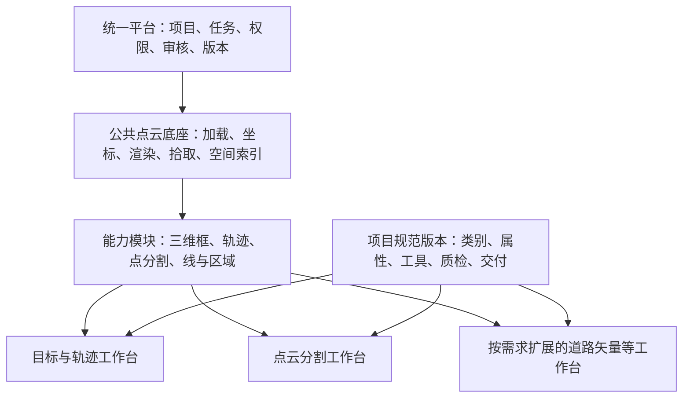
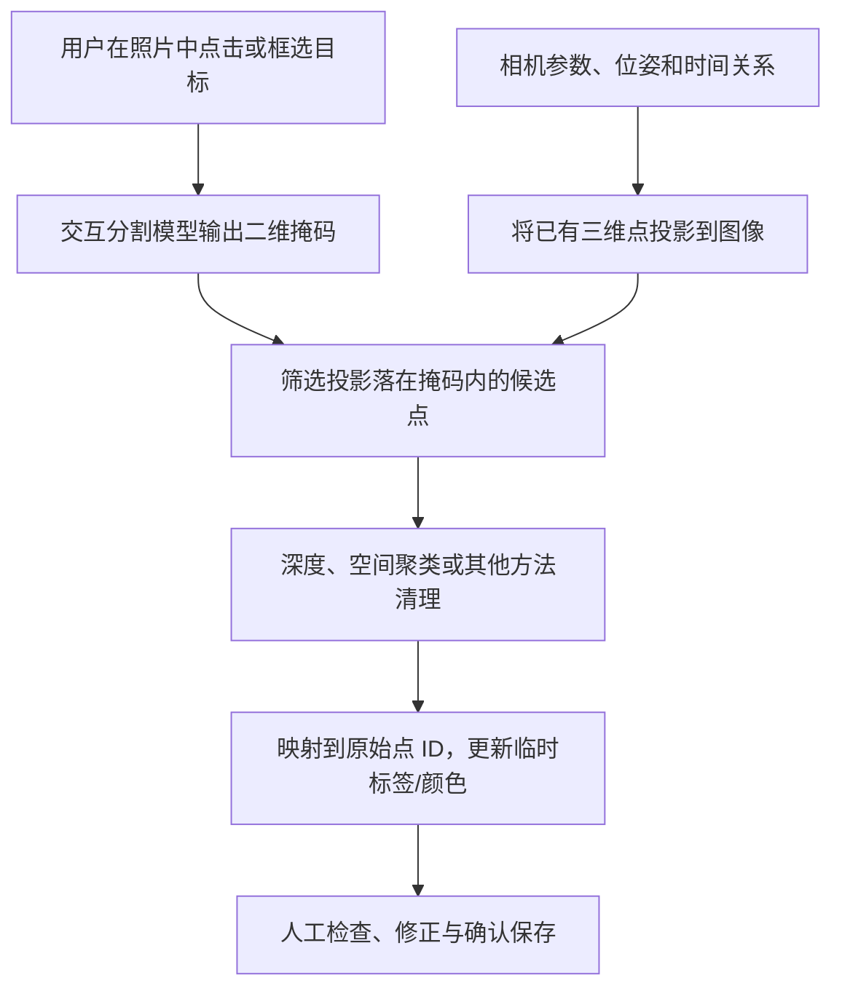

# 通用三维点云标注平台规划：对话总结

- 整理日期：2026-10-22
- 记录范围：本次对话中关于平台定位、任务模板、Vue 前后端架构、点云数据、相机标定、辅助标注及产品开源边界的讨论。
- 文档性质：阶段性规划总结，用于需求梳理与后续技术设计；不是正式需求基线，也不是功能实现或生产验收报告。
- 关联记录：[首次问答：通用三维点云标注平台如何适配不同甲方需求](./2026-10-19-首次问答-通用三维点云标注平台架构.md)。

## 1. 需求背景与当前讨论状态

目标是建设一个能够适配不同甲方规范的通用三维点云数据标注平台。

对话中提出了两类代表性需求：

| 需求示例 | 标注内容 | 期望交付 |
|---|---|---|
| 道路车辆智驾场景 | 给车辆拉三维包围框、标注道路或可行驶区域、关联车辆 ID | 框几何、区域几何、对象属性、跨帧身份 |
| 点云分割场景 | 给规定作业范围内的点赋类别，必要时区分具体实例 | 与原始点对应的语义标签、实例标签 |

用户明确表示：前端项目预计采用 Vue；目前实际接触较多的是“目标与轨迹”和“点云分割”两类作业。

以下内容需要按状态理解：

| 状态 | 内容 |
|---|---|
| 已明确的方向 | 面向不同甲方的通用点云标注平台，前端预计使用 Vue |
| 对话中的架构建议 | 统一平台、公共点云底座、按任务划分模板、按项目规范配置、导入导出适配 |
| 建议的首版切入点 | 两类核心工作台，按实际订单补充基础道路线与区域工具，并打通保存、审核和导出 |
| 尚待确认 | 首版数据协议、数据规模、实际交付样本、坐标与标定条件、后端技术栈、并发与部署要求 |
| 本总结未证明的事项 | 编辑器已实现、模型已部署、真实数据性能达标、多用户作业通过验收 |

Java/Spring Boot、Three.js、Pinia、对象存储和后台 Worker 等在对话中属于实现建议或示例，不应视为用户已经批准的完整技术选型。

## 2. 平台组织原则：按任务复用，按项目配置

### 2.1 不按甲方复制整套平台

建议采用：

> 一个统一平台 + 公共点云底座 + 可复用能力模块 + 少量工作台模板 + 有版本的项目规范 + 数据格式适配器。

多个甲方可以使用同一个任务模板，只调整类别、属性、规则与交付格式。同一个甲方也可能同时需要目标框、分割和道路矢量等多种能力。



### 2.2 配置、模块与适配器各自解决什么问题

| 差异 | 处理方式 | 示例 |
|---|---|---|
| 已有能力的参数或约束变化 | 项目配置 | 类别、颜色、属性、必填项、允许的几何类型、工具开关 |
| 已有作业方式的布局与流程组合变化 | 工作台模板 | 对象列表与轨迹时间轴，或类别列表与分割统计 |
| 新的几何、交互或计算逻辑 | 能力模块开发 | 逐点分割、骨架、体素编辑、特殊曲面操作 |
| 输入文件或交付协议不同 | 导入/导出适配器 | 特定 BIN 布局、甲方 JSON、标签二进制、交付目录 |
| 客户要求隔离运行环境 | 部署配置与隔离设计 | 独立内网部署或独立数据存储 |

配置只能组合已经实现的能力，不能凭空生成新的工具。首版不需要第三方插件市场、复杂微前端或任意 Vue 页面生成系统；先明确模块接口与能力登记即可。

### 2.3 应同时描述数据、任务和结果

“都是点云”不足以说明作业相同。建议用以下维度分析每份需求：

```text
数据来源与组织方式
    + 标注任务
    + 结果表达
    + 项目规范及验收要求
```

例如，同一份道路点云可以用于车辆拉框、逐点分割、道路边界绘制，结果结构与质检方法各不相同。

## 3. 标注任务与结果模型

### 3.1 两类核心任务的区别

| 对比项 | 目标与轨迹 | 点云分割 |
|---|---|---|
| 主要编辑对象 | 车辆、行人、区域、轨迹等实体 | 点集合及其类别或实例归属 |
| 主要操作 | 创建框、调整尺寸与朝向、修改属性、跨帧关联 | 点选、套索、刷选、擦除、批量赋类、实例合并拆分 |
| 典型面板 | 对象列表、属性、三视图、时间轴 | 类别列表、实例列表、选择参数、覆盖统计 |
| 结果 | 几何与身份信息 | 与原始点对应的标签 |
| 主要质量关注 | 框贴合、对象漏标、类别、ID 连续性 | 标签正确性、作业范围覆盖、原始点对应关系 |

三维框通常记录中心、尺寸、旋转、类别和属性。每帧标注记录自身的 `annotationId` 与跨帧身份 `trackId` 应区分：

```text
第 1 帧：annotationId=A101，trackId=T008，框几何=……
第 2 帧：annotationId=A205，trackId=T008，框几何=……
第 3 帧：annotationId=A309，trackId=T008，框几何=……
```

跟踪还需要定义 ID 作用域、遮挡、离开后重现、关键帧、插值和错误关联的修正规则，不是增加一个 ID 输入框即可。

### 3.2 分割的几种含义

| 名称 | 语义 | 示例 |
|---|---|---|
| 语义分割 | 每个点属于什么类别 | 两辆车的点都标为车辆 |
| 实例分割 | 同类点分别属于哪个具体对象 | 车辆实例 A 与车辆实例 B |
| 全景分割 | 统一覆盖规定范围内的前景对象与背景，按规范区分类别和实例 | 车辆分实例，道路等背景赋类别 |
| 时序实例标注 | 跨帧维护同一实例的身份关系 | 各帧中的同一辆车相互关联 |

实例 ID 与跨帧轨迹 ID 的关系需要明确设计；不能默认两者在所有项目中完全相同。已有框内的点也不能直接视为精确目标分割，背景点或相邻对象可能混入。

可参考实际数据表达：[nuScenes 全景标注说明](https://www.nuscenes.org/data-format)。

### 3.3 其他值得预留的任务族

| 任务族 | 典型交付结果 | 主要新增能力 |
|---|---|---|
| 道路矢量与地图要素 | 车道线、路缘、停止线、停车位、可行驶区域等三维线或面 | 顶点编辑、吸附、延伸、拆分合并、图层 |
| 地图拓扑与对象关系 | 车道连接、邻接、分合流、方向、控制关系 | 关系编辑、节点/边 ID、连通性校验 |
| 三维关键点与骨架 | 命名三维点、骨架连接、遮挡状态 | 关键点定位、多视图、骨架约束 |
| 刚体位姿与模型对齐 | 已知模型在场景中的平移与旋转 | CAD/模板模型叠加、姿态操纵、对齐检查 |
| 占用与体素 | 空间网格的占用状态、类别、有效范围 | 体素显示、切片、网格选择与修改 |
| 分类、属性与事件 | 样本类别、对象状态、场景标签、事件时间段 | 表单、事件列表、时间区间和对象关联 |

道路边界折线、可行驶区域多边形、区域内点分类、车道拓扑是不同结果。开放折线不天然形成区域；坡道和立交还需要明确区域所在平面或表面。

占用任务通常区分占用、空闲、未知；没有采样点不等于空间空闲。网格结果也不同于原始点标签，常先经算法生成，再人工检查修正。[Occ3D 官方示例](https://github.com/Tsinghua-MARS-Lab/Occ3D)

任务实例可参考：[Argoverse 三维道路与拓扑](https://argoverse.github.io/user-guide/api/hd_maps.html)、[Waymo 关键点标注](https://waymo.com/open/data/perception/)、[ASAM OpenLABEL 对象与场景表达](https://www.asam.net/standards/detail/openlabel/)。

测绘、林业、仓储、室内扫描、工业检测可以复用其中部分能力，但精度、尺度、坐标、数据量和验收流程需要按行业确认。配准、SLAM、重建、标定优化等可能属于上游处理或专项能力，不应全部默认纳入首版标注编辑器。

## 4. 点云数据的不同之处

### 4.1 点云不一定附带照片

应区分四种条件：

| 数据条件 | 含义 |
|---|---|
| 仅点云 | 可以进行三维几何或点级标注，无照片视窗 |
| 点云带 RGB | 点具有颜色；不保证交付原图、标定或对应时间 |
| 点云加照片 | 照片可辅助人工判断；是否可精确投影还需验证 |
| 点云加照片及有效对应信息 | 具备投影基础；仍要检查标定、位姿、时间和可见性 |

显示的彩色也可能来自高度、反射强度等伪彩色。不能通过“看起来有颜色”推断数据包含照片。

### 4.2 文件格式、来源、组织方式是不同维度

| 维度 | 例子 | 主要影响 |
|---|---|---|
| 文件格式 | PCD、PLY、LAS/LAZ、自定义 BIN | 解析、字段、压缩、精度与元数据 |
| 来源 | LiDAR、RGB-D/深度相机、摄影测量、仿真 | 密度、噪声、颜色、遮挡、精度和辅助信息 |
| 组织方式 | 单帧、连续帧、多扫描站、融合地图 | 时间轴、跟踪、位姿、空间分块与任务切分 |
| 附带资产 | 图像、标定、时间戳、车辆位姿、逐点时间、已有标签 | 联动、补偿、模型辅助与对应关系校验 |

不同格式不需要各自建设一个作业平台。PCD 和 PLY 可以承载相同业务；自定义 BIN 则必须取得字段布局，不能按后缀猜测。

PCD 支持 XYZ、颜色、法向量等字段，并可采用文本或不同二进制编码；LAS/LAZ 常涉及坐标缩放、偏移和分类字段。转换时不能只保留 XYZ 而丢掉交付需要的字段。[PCL PCD 说明](https://pointclouds.org/documentation/tutorials/pcd_file_format.html)、[PDAL LAS/LAZ 说明](https://pdal.io/en/stable/stages/readers.las.html)

### 4.3 不同来源的操作关注点

| 来源/场景 | 作业关注点 |
|---|---|
| 车载 LiDAR | 运动物体、远处稀疏点、帧与传感器同步、轨迹 |
| 固定站或手持扫描 | 静态场景、多站配准结果、密集局部点、裁剪和实例划分 |
| 航空激光扫描 | 大范围地理坐标、分块、回波与分类属性、地形和资产 |
| RGB-D | 深度单位、无效深度、RGB/深度对齐、相机位姿 |
| 摄影测量 | 每张照片的位姿、重建空洞与噪声、尺度和坐标条件 |
| 仿真 | 已有真值的字段和质量、标签导入与修正 |

从照片重建出点云，不代表交付时一定同时获得原图与相机参数；彩色点云也不保证具有可用的投影关系。[Open3D RGB-D 流程](https://www.open3d.org/docs/release/tutorial/geometry/rgbd_image.html)、[COLMAP 重建说明](https://colmap.github.io/tutorial.html)

## 5. 作业流程：公共主线与数据条件分支

公共主线建议保持为：

```text
接收数据与标注规范
  → 识别格式、字段、坐标、时间及辅助资产
  → 校验数据条件，生成内部索引/显示缓存
  → 绑定规范版本、数据版本和作业范围
  → 派工与领取
  → 标注与保存
  → 校验、提交、审核、返工
  → 冻结结果版本并适配导出
```

| 数据组织 | 额外流程 |
|---|---|
| 单帧 | 确认单位、坐标、字段与范围，进入单帧编辑 |
| 连续序列 | 检查顺序、时间戳、位姿，按要求做运动补偿和轨迹一致性检查 |
| 点云加相机图像 | 检查图像对应关系、标定、畸变/裁剪状态与时间，通过后启用投影 |
| 大规模融合地图 | 建空间分块与 LOD，按空间范围派工，检查区域边界一致性 |
| 多站或多时期扫描 | 检查坐标变换与配准结果；是否重新配准由任务范围决定 |

“4D”在本讨论的时序标注语境中指三维场景加时间组织。第四个字段是反射强度，并不使点云成为时序数据。

融合地图若丢失原始帧和时间信息，不能直接恢复逐帧车辆轨迹；动态物体可能留下重影。多个扫描站也不必然意味着时序跟踪任务。

所有显示降采样、过滤、重排和分块都必须保留结果对应关系。持久标签要引用稳定的原始点身份，不使用会随显示变化的顶点索引。

## 6. Vue 前端架构建议

### 6.1 一个作业入口与少量工作区组件

建议统一入口：

```text
/workbench/:taskItemId
```

`taskItemId` 是具体作业任务 ID。前端向后端读取任务上下文，再加载匹配的工作台组合。

```text
WorkbenchPage.vue
└─ WorkbenchShell.vue
   ├─ 公共顶栏：任务信息、保存、提交、审核入口
   ├─ ObjectTrackingWorkspace.vue 或 SegmentationWorkspace.vue
   │  ├─ 公共点云视口
   │  ├─ 当前模式的工具栏
   │  ├─ 对象或类别/实例面板
   │  └─ 按需要显示的时间轴与统计
   └─ 状态提示、校验与加载进度
```

两个 Workspace 可以分别编写。布局与交互有差异是合理的，复用收益来自公共底座与业务能力。[Vue 动态组件机制](https://vuejs.org/guide/essentials/component-basics.html#dynamic-components)

### 6.2 前端职责边界

| 模块 | 职责 |
|---|---|
| WorkbenchShell | 公共作业操作与状态展示 |
| Workspace/Template | 组织布局、面板和操作流程 |
| Tool | 拉框、刷选、套索、轨迹关联等具体操作 |
| PointCloudEngine | 数据加载、坐标、渲染、拾取、空间索引 |
| AnnotationSession | 结果状态、编辑命令、撤销重做、保存协调和版本 |

工具应通过统一会话修改结果：

```text
用户操作 → 编辑命令 → AnnotationSession
         → 更新结果/撤销记录 → 刷新视图 → 统一保存
```

模板和工具代码由前端维护；后端下发结构化配置，前端通过允许的组件/能力登记表加载。模板版本或工具不兼容时，应明确报错，不能静默替换操作方式。

### 6.3 项目配置示意

以下仅说明配置结构，不是已实现的 API 契约：

```json
{
  "specVersionId": "spec-v8",
  "workbench": {
    "templateId": "object-tracking",
    "templateVersion": 1,
    "enabledTools": ["select", "cuboid", "polygon", "track-link"],
    "enabledPanels": ["object-list", "attributes", "timeline"]
  },
  "classes": [
    {
      "id": "car",
      "name": "小汽车",
      "color": "#409EFF",
      "geometryTypes": ["cuboid"],
      "attributes": [
        {
          "key": "occlusion",
          "type": "enum",
          "required": true,
          "options": ["无遮挡", "部分遮挡", "严重遮挡"]
        }
      ]
    }
  ]
}
```

首版先提供稳定布局、类别/属性表单、工具和面板开关；不必立即开发任意拖拽布局设计器。

### 6.4 Vue 与大点云的性能边界

- Vue/Pinia 管理任务、当前工具/类别/帧、面板、权限、进度和统计摘要。
- 点云、标签和空间索引使用 TypedArray、分块数据、Worker 与 GPU 缓冲等方式管理。
- 三维引擎对象不放入深度响应式状态；可用 `shallowRef`、`markRaw` 等方式连接外部引擎。
- 不把每个点变成 Vue 组件，不在每次刷选时复制整份标签。

这是实现建议，不代表经过当前项目性能测试。相关机制参考：[Vue 大型对象与浅层响应式](https://vuejs.org/guide/essentials/reactivity-fundamentals.html#deep-reactivity)。

### 6.5 混合任务：对象层与分割层

同一任务可以同时包含对象层和分割层，分别使用对象编辑、点分割模式；两层可同时显示，当前模式接管编辑手势。

两个模块不能各自上传整份任务结果互相覆盖。统一会话应协调保存与跨层撤销。移动框不默认修改点标签；“将框内候选点赋给某实例”应是明确、可预览、可撤销的操作。

## 7. 后端架构与结果版本

### 7.1 首版可采用模块化后端

| 模块 | 主要职责 |
|---|---|
| 项目与权限 | 项目、成员、访问范围 |
| 标注规范 | 类别、属性、工具、规则、导出方案及版本 |
| 数据资产 | 点云、图像、帧、标定、坐标、原始点映射及版本 |
| 任务 | 派工、领取、负责人、阶段和范围 |
| 标注结果 | 草稿、几何、轨迹、点标签清单和修订 |
| 提交与审核 | 规则检查、提交快照、通过/退回及记录 |
| 导入导出 | 解析、预处理、客户格式适配和文件生成 |

先做好模块边界。耗时导入、预处理和大型导出放后台 Worker；AI 推理按需要独立部署。无需一开始拆成大量微服务。

### 7.2 任务绑定明确的数据与规范版本

```text
Project
  ├─ SpecVersion
  ├─ AssetVersion
  └─ TaskItem：绑定 SpecVersion + AssetVersion + 作业范围
       └─ AnnotationRevision
            ├─ 对象、区域、轨迹结果
            └─ 点标签块清单
                 ↓
            Submission：固定提交的结果版本
                 ├─ Review
                 └─ ExportJob
```

管理员发布规范 v4 后，已绑定 v3 的任务继续使用 v3，除非显式迁移。改变原始数据或点序后，也不能继续无条件沿用旧标签。

### 7.3 前后端接口职责

可提供任务上下文聚合接口，例如 `GET /api/task-items/{taskItemId}/workbench-context`。此路径是设计示例。

返回任务与权限、固定规范、模板能力、数据版本、帧/传感器/标定清单、数据访问地址，以及当前结果版本与引用。大点云和全序列标签按需加载，不全部塞入一个 JSON。

前端规则检查用于及时反馈；后端重新校验权限、作业阶段、类别、属性、结果类型、范围与提交条件。复杂几何或大数据校验可由后台流程完成。

### 7.4 保存、提交与存储

| 内容 | 建议位置 |
|---|---|
| 项目、规范、任务、审核、版本元数据 | 关系数据库 |
| 框、区域、轨迹、对象属性 | 结构化表或按修订保存的 JSON |
| 原始点云、图像、预处理缓存 | 对象存储 |
| 大量逐点标签 | 二进制标签块；数据库保存清单与版本引用 |

草稿保存与提交审核是不同动作。提交应固定不可变结果修订，审核与导出引用确定的版本；混合任务共同校验所要求的结果层。

保存携带 `baseRevision` 进行并发校验，携带请求 ID 支持幂等处理。若当前版本变化，应返回冲突，不静默覆盖。首版可采用单任务独占编辑降低复杂度。

大标签块可先上传为不可变文件，再通过服务端事务发布“几何结果＋标签块清单”的新修订。上传完成不等于保存完成，修订发布成功后才显示已保存。

## 8. 传感器配置、标定与 2D/3D 映射

### 8.1 六摄像头不是统一标准

nuScenes 的采集系统包含六个摄像头和一个 LiDAR，另有毫米波雷达等设备；Waymo Perception 数据使用五个摄像头与五个 LiDAR。它们是具体系统的配置，不是所有采集车的统一标准。[nuScenes 论文](https://arxiv.org/abs/1903.11027)、[Waymo 传感器说明](https://waymo.com/open/data/perception/)

生成本讨论中三维扫描点云的“雷达”主要指激光雷达。360°通常表示水平扫描范围，不表示所有方向和近车区域无盲区。

平台应支持动态传感器列表，六宫格只作为可选布局。

### 8.2 每个相机需要参数，但不是每帧人工调整

每个相机需要内参、成像/畸变模型、相对雷达或车体的外参，以及对应的图像尺寸与处理状态。相同型号也不能假定参数完全一致。

内参和外参通常由采集方或标定流程估计，可采用标定目标、相机与雷达共同观测等方式，必要时联合优化。刚性安装和成像设置稳定、标定仍有效时，可以跨帧复用；安装变化、镜头设置变化或漂移时检查并更新版本。

### 8.3 通过公共车体坐标系计算

约定 `T_A←B` 表示将 B 坐标转换到 A 坐标。对时间对齐的刚性传感器组合：

```text
T_相机i←雷达 = inverse(T_车体←相机i) × T_车体←雷达
P_相机i = T_相机i←雷达 × P_雷达
```

对正确去畸变并采用针孔模型的图像，相机坐标点 `(Xc,Yc,Zc)` 投影为：

```text
u = fx × Xc / Zc + cx
v = fy × Yc / Zc + cy
```

需检查 `Zc > 0` 与图像范围。鱼眼使用对应模型；原图、去畸变/校正图、缩放/裁剪图的参数不能混用。多相机使用各自参数执行同类投影。[OpenCV 相机与投影模型](https://docs.opencv.org/4.x/d9/d0c/group__calib3d.html)

### 8.4 空间标定与时间同步分别处理

雷达采集与相机曝光不同时，运动会造成错位。例如以 10 米/秒行驶，20 毫秒对应 0.2 米位移。

静态场景的时间补偿链可以表达为：

```text
雷达采集时刻的坐标
  → 该时刻车体坐标
  → 世界坐标
  → 相机曝光时刻车体坐标
  → 相机坐标与像素
```

旋转雷达一帧本身跨越一段时间，必要时利用逐点时间戳补偿。车辆自身位姿补偿不能消除目标自身运动误差。[nuScenes 官方投影代码](https://github.com/nutonomy/nuscenes-devkit/blob/master/python-sdk/nuscenes/nuscenes.py)

单个二维像素只约束一条空间射线，不能唯一反求三维点。投影落在同一像素附近的三维点，也未必都在照片中可见。

标定版本属于数据资产，与类别/属性等标注规范分开管理。工作台提供叠加检查，日常作业复用已验证参数，不让标注员逐帧随意调外参掩盖同步问题。

## 9. 2D 抠图辅助点云分割：原理、速度与边界

### 9.1 可实现的技术链路



二维分割可使用 SAM、RITM 等交互模型；掩码表达所选对象的像素范围，类别可以由用户另行指定。

Supervisely 公开教程使用二维掩码、相机标定与 DBSCAN 将分割结果转移到已有点云。它不是从单张照片凭空生成整个三维物体。[官方原理与示例代码教程](https://developer.supervisely.com/getting-started/python-sdk-tutorials/point-clouds/point-cloud-segmentation-with-2d-mask-guidance)

这一教程证明可复现的方法路线，不足以证明当前在线工作台在所有功能模式下使用相同模型和内部实现。

### 9.2 为什么可能很快

- 模型预加载，避免每次点击重新加载权重。
- 预先计算图像特征，同图后续点击复用；SAM 官方预测器包含这一机制。
- 缓存当前数据与相机的点到像素投影，点击后进行掩码查询。
- 只处理候选点和局部区域，而不是反复执行整场景处理。
- 前端复用已加载几何，更新标签/颜色缓冲进行显示。

除 SAM 已公开机制外，这些是本平台可采用的优化建议，不是对 Supervisely 全部内部实现的确认。[SAM 官方预测器](https://github.com/facebookresearch/segment-anything/blob/main/segment_anything/predictor.py)

应分别测量首次打开、首次计算特征、首次点击、后续点击与多人并发延迟。当前没有实测模型、GPU、点数或延迟结论。

### 9.3 不能只靠掩码就保证完整三维实例

目标前后的背景点可能落入同一二维轮廓，相机与雷达存在遮挡差异，单张照片也不能直接识别所有背面点。标定、同步、点密度和掩码边界均会影响结果。

可按场景加入深度/空间过滤、多视角或三维模型，并保留人工修正。聚类不是普适准确性保证。

推荐模块划分为：工作台交互、模型推理、几何融合、标注会话/数据服务、点云渲染。按钮位于浏览器不代表推理全部运行在浏览器；服务器或本地推理位置应由模型与部署条件决定。

验证时先用真实“点云＋同步图片＋标定”与手工掩码检验几何链路，再接入点击分割模型，有助于区分标定问题与模型问题。

## 10. Supervisely 与 Label Studio 的开源边界

以下产品边界在整理时对照官方页面核对；后续产品功能与商业条款可能变化。此处不记录易变的具体价格或额度。

| 产品/内容 | 讨论结论 | 对本项目的含义 |
|---|---|---|
| Supervisely 完整平台 | 官方企业许可将其定义为专有软件；未发现可获得完整平台源码并免费自部署的官方开源版 | 可参考交互与公开方法，不能假定直接 Fork 完整工作台 |
| Supervisely 在线 Community | 提供免费在线计划，但免费在线不等于平台开源 | 使用范围与能力按官方计划确认 |
| Supervisely Enterprise | 提供商业私有部署 | 自部署与源码开放是不同问题 |
| Supervisely Python SDK | SDK 仓库开源，采用 Apache-2.0 | 用于 API、数据和扩展，不能替代完整平台 |
| Supervisely 点云工具公开仓库 | 当前主要为介绍、配置与流程文件，未提供可独立运行的完整编辑器源码 | 不可因仓库名相似就当作完整工作台 |
| Label Studio Community | 有可运行的开源前后端，采用 Apache-2.0，可自行部署与二次开发 | 可以评估其项目、任务、配置与模型接入设计 |
| Label Studio 官方 LiDAR Interface | 官方模板页面限定用于 Enterprise 与 Starter Cloud | 不能认为安装社区版就获得该商业点云工作台 |

Supervisely 依据：[版本与部署对比](https://supervisely.com/pricing/)、[平台许可](https://supervisely.com/eula/)、[Python SDK 及许可](https://github.com/supervisely/supervisely)、[点云工具仓库](https://github.com/supervisely-ecosystem/pointcloud-labeling-tool)。

Label Studio 依据：[开源仓库](https://github.com/HumanSignal/label-studio)、[社区版与商业版对比](https://labelstud.io/guide/label_studio_compare.html)、[LiDAR Interface 限制](https://labelstud.io/templates/interfaces-lidar)。

公开算法示例或生态仓库的许可应分别检查，不能把 SDK 许可证外推到所有代码、模型、权重和数据。基于 Label Studio 二次开发，还是自研点云工作台，目前仍未做最终决策。

## 11. 首版范围与验证重点

### 11.1 建议按真实需求分阶段

| 阶段 | 建议范围 |
|---|---|
| 首版形成闭环 | 少量明确格式与数据包协议；目标/轨迹、语义/实例分割；按订单补充基础道路线/区域；规范配置、保存恢复、审核、导出 |
| 提升效率 | 多视图、相机联动、选择优化、插值/传播、模型辅助、质检规则 |
| 专项扩展 | 道路拓扑、关键点/骨架、刚体位姿、占用体素及测绘/工业能力 |

这不是已锁定的开发排期。若首个合同要求相机联动或某项工具，它就属于该项目首版必需范围，不能因阶段表而延后。

### 11.2 首版验收应覆盖真实交付链

1. **数据**：真实样本的字段、坐标、单位、帧、标定和时间条件可解析并正确展示。
2. **编辑**：目标或点标签按规范生成，选择范围与实际被修改的原始点一致。
3. **持久化**：保存后刷新/重开可恢复；撤销重做和版本冲突符合规则。
4. **任务**：领取、权限、提交、审核与返工流转正确。
5. **交付**：导出结果与内部修订一致，客户格式、坐标、ID 和原始点对应关系通过核验。
6. **性能**：在明确硬件、点数、帧数、网络和并发条件下测量，不能用静态页面或演示替代。

可计算检查和人工判断需分开：必填字段、ID 约束、未分类点统计可以规则化；漏掉整辆车或标签语义错误不一定能靠格式校验发现。

## 12. 下一步需要确定的事项

| 待确定项 | 需要拿到或决定的内容 |
|---|---|
| 两类代表样本 | 各一套真实目标/轨迹与分割数据，配套预期交付结果 |
| 输入协议 | 格式、字段布局、目录、帧清单、图片关联、已有标签与错误处理 |
| 坐标与时间协议 | 坐标系、单位、旋转约定、标定方向、时间单位、逐点时间、去畸变/补偿状态 |
| 任务与 ID 规则 | 单帧/序列/区域范围、实例/轨迹作用域、跨层关联与忽略区域 |
| 项目规范 | 类别、属性、工具、质检、完整性与导出规则 |
| 规模与运行条件 | 单帧/地图点数、文件和序列大小、客户端硬件、网络、并发、内网要求 |
| 技术选型 | Vue 版本与状态管理、三维引擎、后端、数据库、存储、Worker、模型部署 |
| 首版边界 | 必需能力、可后续能力、模型调用位置与人工确认方式 |

后续设计可从“输入数据协议、标注结果协议、规范配置协议、任务上下文与保存协议”四份契约开始，再细化页面、模块接口和验收用例。

## 附录：本次讨论主题索引

| 对话主题 | 本文位置 |
|---|---|
| 不同甲方是否分别开发平台 | 第 1～2 节 |
| Supervisely 点击二维目标后点云变色 | 第 9 节 |
| Supervisely 是否开源 | 第 10 节 |
| 首次问答保存与上传 | 文首关联记录 |
| Label Studio 是否有开源版本 | 第 10 节 |
| Vue 前端和后端如何设计 | 第 6～7 节 |
| 多相机、雷达与标定映射 | 第 8 节 |
| 除目标/轨迹与分割以外的标注任务 | 第 3 节 |
| 点云类型、照片条件与作业差异 | 第 4～5 节 |
| 开发范围与后续决策 | 第 11～12 节 |
